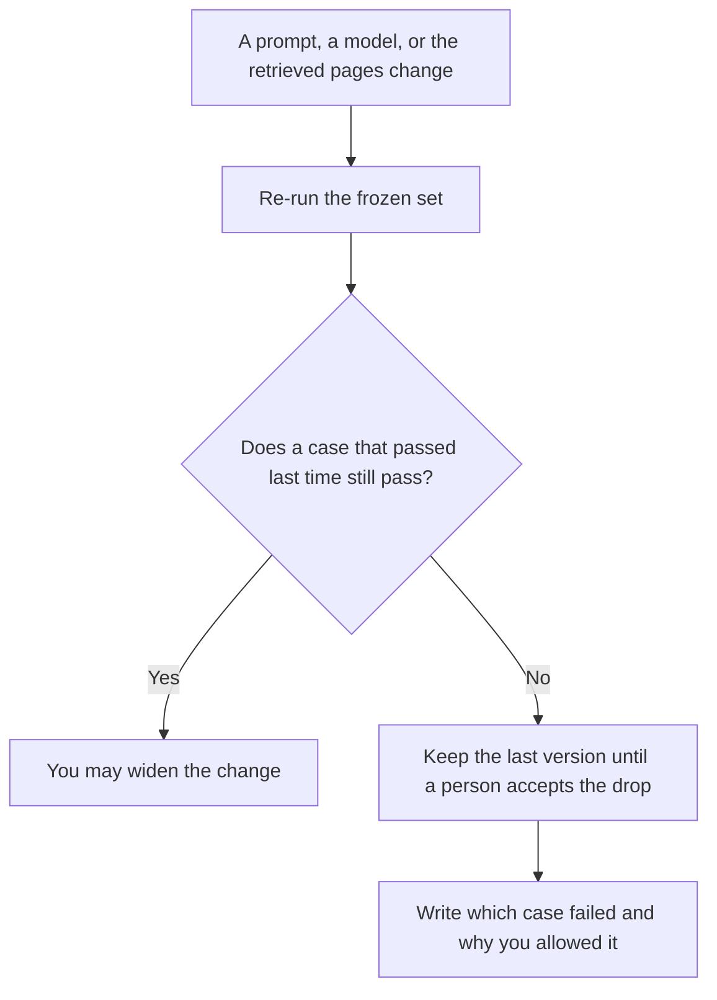

**Prompt regression testing is a re-run of a frozen set of prompts, scored the same way as last time, so you can see which answers got worse after a prompt edit, a model swap, or a retrieval change.** A new demo can look better and still break the refund case you already accepted. The regression is the comparison to that accepted run. If you have no saved baseline, you have a fresh test, and a fresh test cannot tell you what you lost.

The habit of choosing the tasks is [what AI eval testing is](/blog/what-is-ai-eval-testing-2026/). The files and the runner are [what an AI eval harness is](/blog/what-is-ai-eval-harness-2026/). The wording you are allowed to change is [what prompt versioning is](/blog/what-is-prompt-versioning-2026/). A wrong sentence that was not in the source is [what an AI hallucination is](/blog/what-is-ai-hallucination-2026/).

Prices are US list prices excluding tax from directory pages checked October 16, 2026. Published October 24, 2026. The directory does not list a prompt-regression product fee, so this page does not invent one. We did not score any model.

## What you keep from the last good run

| You save | Why the next run needs it | Leave it out when |
|---|---|---|
| The exact prompt text, with a version id | A paraphrase is a different test | You are still brainstorming wording in a doc |
| The inputs: the ticket, the schema, the chunk | The answer depends on what the model saw | The input is a secret you are not allowed to store |
| The score rule, in one sentence | "Looks fine" cannot fail a build | You have not agreed what "wrong" means |
| The last passing result, or the last score | Regression is a diff | This is the first time you have run the case |
| Who may accept a drop | A quieter failure still ships if nobody owns the exception | The change is a local experiment that will not merge |

A green average can hide one broken case. Report the cases that flipped, not only the mean. The person who may accept a drop is [what human-in-the-loop AI is](/blog/what-is-human-in-the-loop-ai-2026/).

## Where the baseline is written

**The long case file.** [Claude](/tools/claude/) Pro is $20 a month, or $17 billed annually ($200 up front). Put the frozen prompts and the score rule in a Project so a later edit cannot quietly rewrite the test. The review is [Claude review](/blog/claude-review-2026/).

**The team's default chat.** [ChatGPT](/tools/chatgpt/) Plus is $20 a month. Business is $20 a user a month billed annually for two or more users, or $25 billed monthly, when the cases include customer text. The ladder is [ChatGPT Go vs Plus vs Pro](/blog/chatgpt-go-vs-plus-vs-pro-2026/).

**The change, if it lives in the repo.** [Cursor](/tools/cursor/) Plus for new customers is $8 a month, or $80 a year. Premium is $30 a month. The regression still needs a command you can run again. The editor is not the harness. The invoice is [Cursor pricing explained](/blog/cursor-pricing-explained-2026/).

**A table of pass and fail the team can reopen.** [Hex](/tools/hex/) Professional is $36 an editor a month when the scores should be a notebook, not a chat scroll. Community is free, with a Hex agent trial and small compute. The invoice is [Hex pricing explained](/blog/hex-pricing-explained-2026/).

A prompt that holds the line, for drafting the score rule only:

"Here are ten cases and the last accepted answer for each. Write a pass rule a person can apply without taste. If a case has no accepted answer, write Missing. Do not invent a score."

## What a regression is allowed to block

Block a ship when a named case flips from pass to fail and nobody has accepted that flip in writing. A model upgrade is a change. A temperature tweak is a change. A new help article in the retrieval set is a change. Each one gets the same re-run.

Do not block a ship because a case looks different and the score rule never said that difference was a failure. Style drift without a rule is a note, not a red build. The switch that can keep the new prompt off production while you argue is [what AI feature flags are](/blog/what-is-ai-feature-flags-2026/). The live slice, once you do expose it, is [what AI canary releases are](/blog/what-is-ai-canary-releases-2026/).

## FAQ

### Is a regression the same as an eval?

An eval is the set and the score. A regression is the next run compared with a run you already accepted. You can have an eval on day one. You can have a regression only after you have a baseline.

### How many cases do I need?

Enough that a failure you would be ashamed to ship is in the set. Ten honest cases beat two hundred copied from a public benchmark you do not serve. Add a case when production breaks in a way the set missed.

### Can the model grade its own regression?

It can propose a score. A person, or a check that does not depend on the same prompt you just changed, confirms the flip. A model grading a change to itself is a review with a conflict.

### What if the new model is better on average and worse on one case?

Say both. The average is not permission to drop the case. Either accept the drop, with a name and a date, or keep the last prompt for that path.

## Last verified

October 16, 2026 for Claude, ChatGPT, Cursor, and Hex prices named above. No prompt-regression vendor fee is recorded in the directory. Published October 24, 2026.

**Sources:** [Claude pricing](https://claude.com/pricing), [ChatGPT pricing](https://chatgpt.com/pricing/), [Cursor pricing](https://cursor.com/help/account-and-billing/pricing).

*Published by Andrew for [AI Tools Optimizer](https://aitoolsoptimizer.com).*

[Claude](/tools/claude/) is in the [chatbots and assistants directory](/tools/category/chatbots-assistants/). Directory pages may use affiliate links. A purchase through them may earn us a commission at no extra cost to you.
