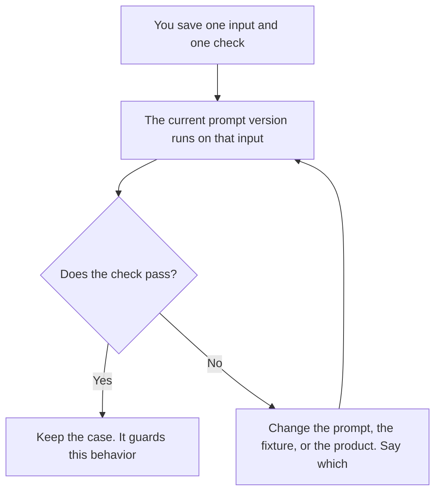

**Prompt unit testing is one prompt version, one saved input, and one check that this case either passes or fails on its own.** The fixture is a ticket, a paragraph, or a JSON object you are allowed to store. The check is a sentence you wrote: the field is present, the refusal happened, the number matches the source. A unit test does not need a previous run. If this fixture fails, this prompt fails that case.

A whole set of tasks, chosen on purpose, is [what AI eval testing is](/blog/what-is-ai-eval-testing-2026/). The files and the runner around them are [what an AI eval harness is](/blog/what-is-ai-eval-harness-2026/). A re-run that asks whether last month's good answers still pass is [what prompt regression testing is](/blog/what-is-prompt-regression-testing-2026/). The id on the wording you are testing is [what prompt versioning is](/blog/what-is-prompt-versioning-2026/).

Prices are US list prices excluding tax from directory pages checked October 16, 2026. Published October 24, 2026. The directory does not list a prompt-unit-test product fee, so this page does not invent one. We did not score any model.

## What one case contains

| Piece | A unit test has | Leave it out when |
|---|---|---|
| Prompt version | The exact text, with an id | You are still brainstorming in a doc |
| Fixture | One input you are allowed to store | The input is a secret, or it is "a typical customer" |
| Check | One rule that can fail | The rule is "looks helpful" |
| Expected shape | Fields you named, if the output is structured | You have not decided the fields |
| Owner | A person who updates the fixture when the product changes | Nobody would notice a failure |

The expected shape, when you need fields rather than a paragraph, is [what an AI output schema is](/blog/what-is-ai-output-schema-2026/). A unit test can assert that schema. It still cannot assert that the product is good. One refund fixture does not cover the outage fixture.

## Where the case is written

**The prompt under test.** [Claude](/tools/claude/) Pro is $20 a month, or $17 billed annually, when the prompt and the fixture live in a Project so a later edit is a diff. Free can hold one case while you learn the habit. The review is [Claude review](/blog/claude-review-2026/).

**A second wording of the same check.** [ChatGPT](/tools/chatgpt/) Plus at $20 a month can turn a messy note into a single assertion. Keep the assertion. Discard a second fixture the model invented. The review is [ChatGPT review](/blog/chatgpt-review-2026/).

**The check next to code.** [Cursor](/tools/cursor/) Plus is $8 a month, or $80 a year, when the unit test is a file in the repo that calls the prompt. The editor does not decide the expected value. You do. Writing executable tests is [Cursor vs GitHub Copilot for tests](/blog/cursor-vs-github-copilot-for-tests-2026/).

**A table of cases.** [Hex](/tools/hex/) Professional is $36 per editor a month when the fixtures are rows and you want the pass/fail next to them. Community is free with an agent trial. The notebook is not the prompt. The invoice is [Hex pricing explained](/blog/hex-pricing-explained-2026/).

## What a failure means

A failed unit test means this fixture did not meet this check on this prompt version. It does not mean the model is worse than another model. It does not mean you should change the check until the run is green. If the product behavior changed on purpose, update the fixture and say so in the version note.

A file check that catches a broken template before you run the case is [what a prompt linter is](/blog/what-is-prompt-linter-2026/). Lint is cheap. It is not a substitute for the fixture.

## FAQ

### How is a unit test different from a regression test?

A unit test can fail the first time you run it. It guards one case. A regression test compares a frozen set to the last run you accepted. You want both once the prompt is in a product. Starting with one fixture is the unit test. Saving the passing output for next month is how that case becomes part of regression.

### How many fixtures do we need?

Enough that each behavior you refuse to lose has one case. A dozen thoughtful fixtures beat a hundred paraphrases of the same ticket. Add a fixture when a real failure had no case, after you are allowed to store that input.

### Can the model write the expected answer?

Only as a draft you correct against the source of truth. If the model writes the expected value and then grades itself, the test checks consistency, not correctness. A wrong expected value locks the bug in.

### Does this belong in the eval harness?

Yes, once you have more than a handful of cases and you want them run the same way every time. The harness is the runner. The unit test is one file it runs. You can keep a single fixture in a doc while you decide the check.

## Last verified

October 16, 2026 for Claude, ChatGPT, Cursor, and Hex. Published October 24, 2026.

**Sources:** [Claude pricing](https://claude.com/pricing), [ChatGPT pricing](https://chatgpt.com/pricing/), [Cursor pricing](https://cursor.com/help/account-and-billing/pricing), [Hex pricing](https://hex.tech/pricing/).

*Published by Andrew for [AI Tools Optimizer](https://aitoolsoptimizer.com).*

[Claude](/tools/claude/) is in the [chatbots and assistants directory](/tools/category/chatbots-assistants/). Directory pages may use affiliate links. A purchase through them may earn us a commission at no extra cost to you.
