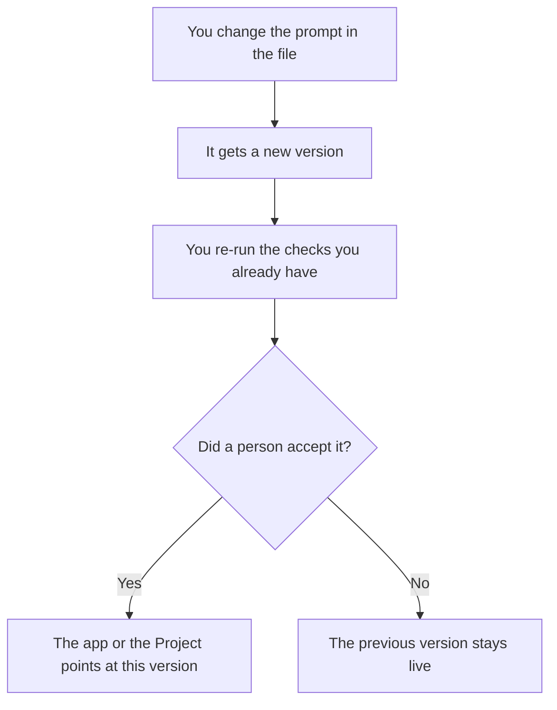

**Prompt versioning is treating the wording you send a model as a file with a number, an owner, and a reason for the last change.** When an answer gets worse on Thursday, you can see what the prompt said on Wednesday. A prompt that lives only in a chat box has no Thursday.

The shared shelf of prompts people reuse is [what a prompt library is](/blog/what-is-a-prompt-library-2026/). The hidden instruction the user does not edit is [what a system prompt is](/blog/what-is-a-system-prompt-2026/). The tests you re-run after a wording change are [what an AI eval harness is](/blog/what-is-ai-eval-harness-2026/).

Prices below are US list prices from directory pages checked October 16, 2026. Published October 24, 2026. The directory does not list a prompt-versioning product price. We did not score prompt tools.

## What belongs in a version

| Field | Why it is there | Leave it out |
|---|---|---|
| The text, exactly | So you can diff it | A paraphrase of what you "usually say" |
| A number or a git commit | So logs can point at it | "Final-final" in a doc title |
| The owner | So someone can reject a change | A shared inbox |
| The model it was written for | Wording that worked on one model can fail on another | A claim that it is universal |
| The eval result, if you ran one | So a prettier prompt that fails the task does not ship | A screenshot of one lucky answer |

One example inside the prompt is [what few-shot prompting is](/blog/what-is-few-shot-prompting-2026/). Asking with no example is [what zero-shot prompting is](/blog/what-is-zero-shot-prompting-2026/). Version both. An example that contains a customer's private data does not belong in the shared file.

## Where the file can live

**A Project, for people who prompt by hand.** [Claude](/tools/claude/) Pro is $20 a month, or $17 billed annually. Put the current prompt in a Project and keep older wording in the same doc with dates, or in git if more than one person edits it. Projects are not a full version history by themselves. The comparison is [Claude Projects vs ChatGPT Projects](/blog/claude-projects-vs-chatgpt-projects-2026/).

**A custom GPT or a Project on the other seat.** [ChatGPT](/tools/chatgpt/) Plus is $20 and includes projects and custom GPTs. Export the instructions when you change them. A GPT you edit in place without a copy is how "final" disappears. The ladder is [ChatGPT Go vs Plus vs Pro](/blog/chatgpt-go-vs-plus-vs-pro-2026/). Go at $8 is a usage step. It is a weak archive.

**The wiki page the team treats as the library.** [Notion AI](/tools/notion-ai/) Business is $20 a seat. Page history helps. It is still a wiki. If the prompt runs in production, the production system should store the version id, not only the Notion link. The card is [Notion AI pricing explained](/blog/notion-ai-pricing-explained-2026/). The library habit is the prompt-library explainer linked above.

**Git, when the prompt ships in code.** [Cursor](/tools/cursor/) Plus is $8 a month, or $80 a year, for new customers. [GitHub Copilot](/tools/github-copilot/) Pro is $10. A pull request is a version. The person who merges is the owner. Team admin for those seats is [Cursor vs GitHub Copilot for teams](/blog/cursor-vs-github-copilot-for-teams-2026/). The individual day-to-day comparison is [Cursor vs GitHub Copilot](/blog/cursor-vs-github-copilot-2026/).

Which version is live for which users is a flag, not a hope. That switch is [what AI feature flags are](/blog/what-is-ai-feature-flags-2026/).

## A change that counts

Changing a verb, adding a banned promise, or swapping the example all count. Fixing a typo in a comment next to the prompt can count if the comment is not sent. Say which part the model sees.

Run the same tasks after the change. A prompt that reads better and fails the refund case is a regression. The task list is [what AI eval testing is](/blog/what-is-ai-eval-testing-2026/). The person who accepts the new version is [what human-in-the-loop AI is](/blog/what-is-human-in-the-loop-ai-2026/).

When an incident traces back to wording, the path from output to prompt version is [what AI data lineage is](/blog/what-is-ai-data-lineage-2026/). If you cannot name the version, you cannot honestly say you fixed it.

## FAQ

### Is a prompt library the same as versioning?

A library is the shelf. Versioning is the history of one item on the shelf. You can have a folder of prompts and still overwrite the only copy. Number the copy you run.

### Do chat conversations count as versions?

They count as drafts. The version is the text you deliberately saved and pointed production at. Scrollback is a poor archive. It mixes experiments with the live wording.

### How many versions should I keep?

Keep every version that served a user, for as long as you keep those logs. Keep experiments that failed the eval if they taught you a constraint. Delete scratch drafts that never left your machine.

### Should the model rewrite its own system prompt?

A person approves that change and saves a new version. An agent that edits the live prompt with no diff will ship a wording nobody can roll back. The broader pattern of who hands work to whom is [what AI agent orchestration is](/blog/what-is-ai-agent-orchestration-2026/).

## Last verified

October 16, 2026 for Claude, ChatGPT, Notion, Cursor, and GitHub Copilot prices named above. No dedicated prompt-versioning fee is on those cards. Published October 24, 2026.

**Sources:** [Claude pricing](https://claude.com/pricing), [ChatGPT pricing](https://chatgpt.com/pricing), [Notion AI](https://www.notion.com/product/ai).

*Published by Andrew for [AI Tools Optimizer](https://aitoolsoptimizer.com).*

[Claude](/tools/claude/) is in the [chatbots and assistants directory](/tools/category/chatbots-assistants/). Directory pages may use affiliate links. A purchase through them may earn us a commission at no extra cost to you.
