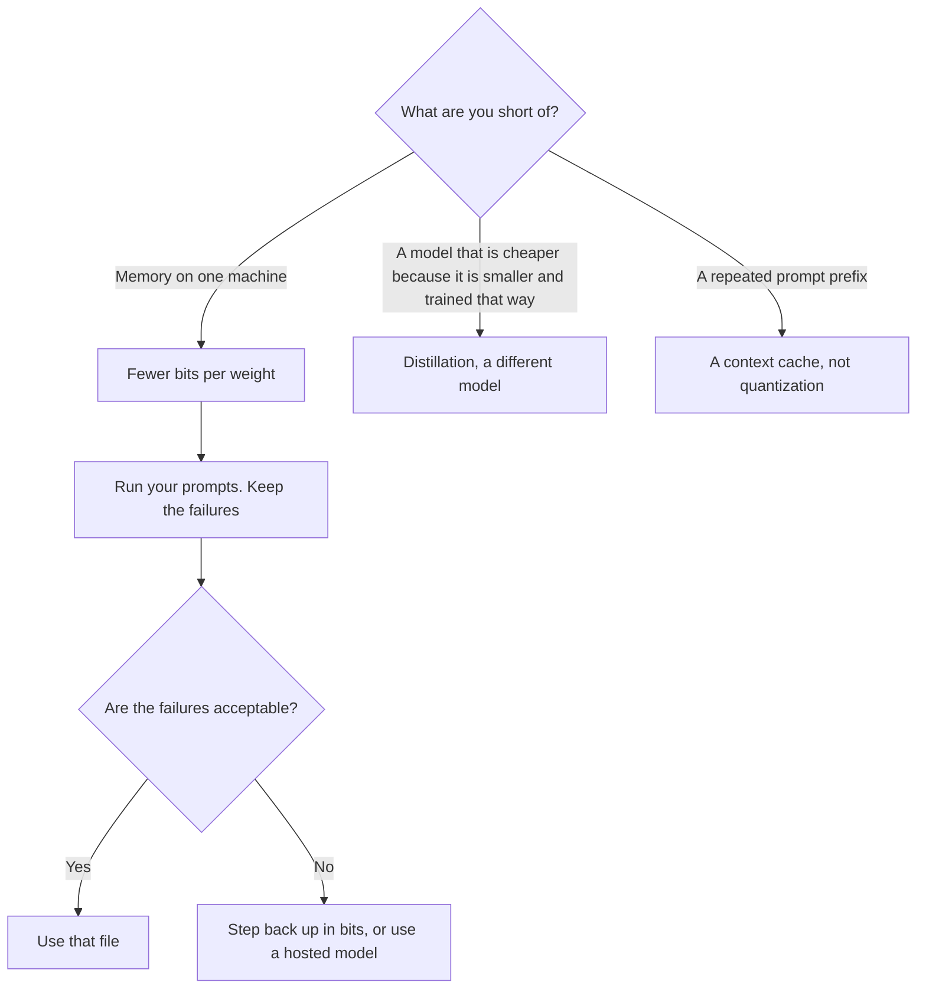

**Quantization stores a model's numbers in fewer bits so the same model takes less memory and often needs less hardware to answer.** A weight that lived in a roomy format gets rounded into a smaller one. The file shrinks. Some answers can get worse. You only know which answers if you check the prompts you care about.

The work being made cheaper is [inference, not training](/blog/what-is-ai-inference-vs-training-2026/). The check is [what AI eval testing is](/blog/what-is-ai-eval-testing-2026/). The unit of the answer is still [a token](/blog/what-are-ai-tokens-explained-2026/).

Published October 24, 2026. This page does not publish a quality drop for any bit width. A percentage you did not measure on your prompts is a rumor.

## What people are pointing at

| Phrase you will hear | What it usually means | What it does not mean |
|---|---|---|
| FP16 or BF16 | A common full-serving format | "Unquantized" in some sentences, already reduced in others |
| INT8 or FP8 | About a byte per weight | A free guarantee of the same answers |
| INT4 or "4-bit" | A tighter file, often for a machine with less memory | A new model with a new name |
| Weight quantization | The stored parameters use fewer bits | The prompt got shorter |
| KV-cache quantization | The running conversation state uses fewer bits | The weights changed |
| A GGUF or similar file | A packaged checkpoint you can run locally | A hosted API plan |

Rounding is the whole trick. Values that used to be distinct can collapse. For a chat about the weather you may never notice. For a column of figures, a citation, or a diff, you might. The eval set has to include the prompt that would embarrass you. A generic "helpfulness" score will not catch a wrong total.

## Three neighbors that are easy to mix up

**Distillation trains a smaller model.** Quantization compresses the model you already have. A distilled model can also be quantized later. If the product changed because someone trained a student model, read [what model distillation is](/blog/what-is-model-distillation-2026/).

**A context cache reuses a prefix.** It does not change the weights. DeepSeek's directory page records a vendor claim of a smaller KV cache on their architecture, and it records cache-hit prices. That is a cache design on a hosted API. It is not a file you quantize yourself. The pricing shape is [what a context cache is](/blog/what-is-a-context-cache-2026/). The bill is [DeepSeek review](/blog/deepseek-review-2026/): Flash cache-miss input is $0.15 per million tokens off-peak.

**Speculative decoding adds a draft model.** It does not throw away bits of the target model. You can do both. The draft-and-check definition is [what speculative decoding is](/blog/what-is-speculative-decoding-2026/).

Downloading weights and running them is a separate decision from picking a format. The license and the checkpoint are [what open-source AI is](/blog/what-is-open-source-ai-2026/). A 4-bit file of a model you are not allowed to ship is still a model you are not allowed to ship.

## What a chat seat has to do with this

[ChatGPT](/tools/chatgpt/) Plus at $20 and [Claude](/tools/claude/) Pro at $20, or $17 billed annually, do not hand you a bit-width slider. You buy usage of a hosted model. Quantization, if that vendor uses it, is inside their serving stack. You will not see it on the seat invoice. Do not explain a bad answer as "probably the quantization" unless you chose the file.

[GitHub Copilot](/tools/github-copilot/) is the same shape. Free is 2,000 completions a month. Pro is $10. You are not selecting INT4. The plan page is [GitHub Copilot pricing explained](/blog/github-copilot-pricing-explained-2026/).

Choose a local quantized file when you need the weights on hardware you control and you will run evals. Choose a hosted plan when you want a vendor to own the serving stack and the cap is the number you can explain. The two clocks, if the local file is "faster" only in a demo, are [latency vs throughput](/blog/what-is-ai-latency-vs-throughput-2026/).

## FAQ

### Does 4-bit always lose quality?

It can. It does not have to, on every prompt. This page will not quote a percentage. Run the prompts that matter, including the ones with numbers, names, and citations. Keep the failures next to the bit width you used.

### Is quantization training?

Not by itself. You take a trained model and store it more tightly. Some pipelines add a short calibration step so the rounding hurts less. That step is not "training a new model" in the sense of the inference-versus-training split, unless you are actually updating the model to learn.

### Will a quantized model use fewer tokens?

No. Tokens are the prompt and the answer. Quantization changes how the weights are stored. A shorter answer is a different decision. The window is [what a context window is](/blog/what-is-a-context-window-2026/).

### Should I quantize a model to save API fees?

API fees are the hosted price. Quantizing a local copy does not discount DeepSeek's or anyone else's API. It replaces that API with a machine you operate. Price the machine, the power, and the eval time before you call it cheaper.

## Last verified

October 16, 2026 for the seat prices and the DeepSeek Flash cache-miss rate named above. Published October 24, 2026. Bit-width definitions do not depend on those prices.

**Sources:** [DeepSeek API docs](https://api-docs.deepseek.com/), [Claude pricing](https://claude.com/pricing), [GitHub Copilot](https://github.com/features/copilot).

*Published by Andrew for [AI Tools Optimizer](https://aitoolsoptimizer.com).*

[DeepSeek](/tools/deepseek/) is in the [chatbots and assistants directory](/tools/category/chatbots-assistants/). Directory pages may use affiliate links. A purchase through them may earn us a commission at no extra cost to you.
