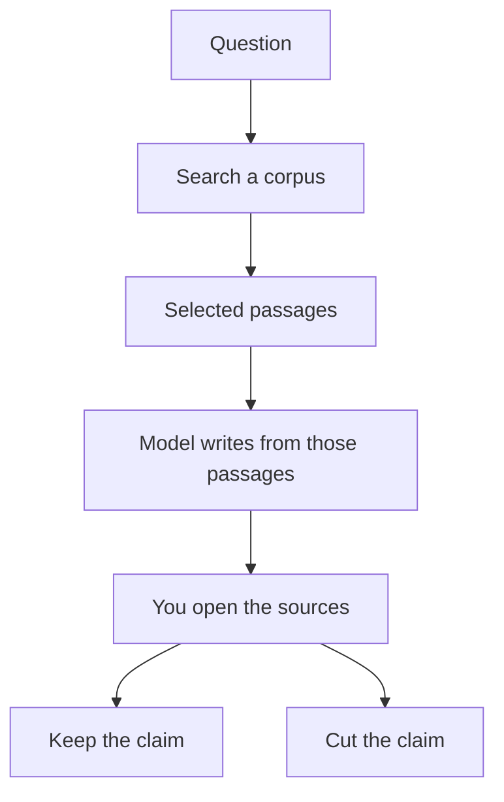

**RAG, retrieval-augmented generation, means the model looks up passages first and writes the answer from those passages.** The lookup is the point. Without it, the model is writing from training. With it, you can open the page, the paper, or the help article the sentence came from. The acronym is the method. The product is whatever does the lookup and shows you the source.

You care about RAG when the answer has to be true of a specific corpus: your help center, a set of papers, a contract folder, yesterday's web. You do not need the acronym when you are brainstorming a headline. A prompt is enough for that.

Nothing below is a lab score of retrieval quality. A citation is a link. Open it. Prices are US list prices excluding tax from pages recorded in this directory on October 16, 2026, or in a later article that names October 24, 2026.

## What the steps are

1. You ask a question, or a customer does.
2. The system searches an index: the web, a paper corpus, or files you uploaded.
3. It selects passages.
4. The model writes an answer that is supposed to stay inside those passages.
5. You get the answer and the sources. Step 5 is useless if nobody opens them.

A chatbot with a long prompt can imitate this if you paste the sources yourself. That is manual RAG. It works for one document. It falls over when the corpus is a help center or a literature review. The limit on how much you can paste is the [context window](/blog/what-is-a-context-window-2026/).

## Which product is already doing the lookup

| The corpus | Use this | Why it matches the method | Price to know |
|---|---|---|---|
| The public web, with links | [Perplexity](/tools/perplexity/) | Answers ship with citations. Pro adds Computer and premium data | Pro is $17/month billed annually |
| Peer-reviewed papers, as a cited answer | [Consensus](/tools/consensus/) | Search stays on papers. Pro messages are the analysis meter | Pro is $12/month on a $144 year, or $20 monthly |
| Papers, as a table of extracted fields | [Elicit](/tools/elicit/) | Rows are papers. Columns are the fields you name | Plus is $11/user/month billed annually on the non-Industry card |
| Files you upload and trust | [Gemini Notebook](/tools/gemini-notebook/) | The notebook stays on your sources | Free with a Google account. Google AI Plus is $4.99/month |
| Your help center, in front of customers | [Chatbase](/tools/chatbase/) | The agent is trained on content you connect | Hobby is $32/month billed yearly |
| The wiki your team already writes | [Notion AI](/tools/notion-ai/) | Answers can use the workspace | Business is $20/seat/month for full Notion AI |
| A draft you are writing from notes you paste | [Claude](/tools/claude/) | You supply the passages. The model does not fetch your private corpus by default | Pro is $20/month, or $17 billed annually |

Perplexity's research desk is [Perplexity review](/blog/perplexity-review-2026/). The split between web, papers, and a chatbot is [Perplexity alternatives](/blog/perplexity-alternatives-2026/). A site bot's bill is [Chatbase review](/blog/chatbase-review-2026/).

## RAG, prompting, and fine-tuning are different fixes

| Problem | Fix |
|---|---|
| The model does not know a fact that lives in a document | RAG, or paste the document |
| The model knows the facts and you want a different shape of answer | A prompt, an example, or a template |
| You want the model to default to a style or a format across thousands of calls, and the facts are stable | [Fine-tuning](/blog/what-is-fine-tuning-ai-2026/), which is a training job, not a search box |
| The fact changes every week | RAG or a fresh paste. A tuned model will keep yesterday's price |

Support bots fail in a predictable way: the help article is missing, and the model fills the gap. The fix is the article, then the retrieval, then a handoff to a person. A larger model does not invent a return policy you never wrote.

Research fails in a different way: the citation exists and does not say what the summary says. That is why Consensus and Elicit are in the table, and why the workflow is [how to research papers with Elicit and Consensus](/blog/how-to-research-with-elicit-and-consensus-2026/). For a blog post, the same rule is [how to write a blog post with Claude](/blog/how-to-write-a-blog-post-with-claude-2026/): you collect the sources, then the draft.

## What to ask before you buy a "RAG platform"

- Which corpus is searched, and what is excluded?
- Can you see the passage, not only a title?
- What happens when retrieval finds nothing? The honest behavior is "I don't know," plus a handoff.
- Is your content used to train someone else's model? That sentence lives on the enterprise card of several tools. Read it on the plan you will actually buy.
- What is the meter: seats, messages, credits, or queries?

[Gemini Notebook](/tools/gemini-notebook/) is the clean case of "only my files." The study version of that habit is [how to study with Gemini Notebook](/blog/gemini-notebook-study-workflows/). Perplexity is the clean case of "the web, with links." They answer different questions. Stacking them is reasonable. Expecting one subscription to do both is how citations get vague.

## FAQ

### Is Perplexity RAG?

It retrieves web sources and generates an answer with citations. That is the pattern, whether or not the pricing page uses the acronym. Pro at $17 a month billed annually adds limits, model choice, and Computer. Open the citation either way. The plan detail is [Perplexity pricing explained](/blog/perplexity-pricing-explained-2026/).

### Is a long prompt the same as RAG?

Only for the text you pasted. The model is not searching the rest of your drive. When the source is longer than the window, or there are hundreds of sources, you want a system that retrieves a subset.

### Does RAG stop hallucinations?

It gives you a source to check, and it gives the model passages to stick to. It does not guarantee the summary matches the passage. Treat "grounded" as a design goal you still verify.

### Do I need a vector database?

You need one if you are building retrieval into your own product. You do not need to stand one up to use Perplexity, Consensus, Elicit, Notebook, Chatbase, or Notion. Those products hide the index.

## Last verified

October 16, 2026 for plan prices carried from directory tool pages, and October 24, 2026 where a linked review re-read the vendor page. The definition does not depend on a price change.

**Sources:** [Perplexity pricing](https://www.perplexity.ai/pro), [Consensus pricing](https://consensus.app/pricing/), [Elicit pricing](https://elicit.com/pricing), [Chatbase pricing](https://www.chatbase.co/pricing).

[Perplexity](/tools/perplexity/), [Consensus](/tools/consensus/), and [Elicit](/tools/elicit/) are in the [research and search directory](/tools/category/research-search/). Directory pages may use affiliate links. A purchase through them may earn us a commission at no extra cost to you.
