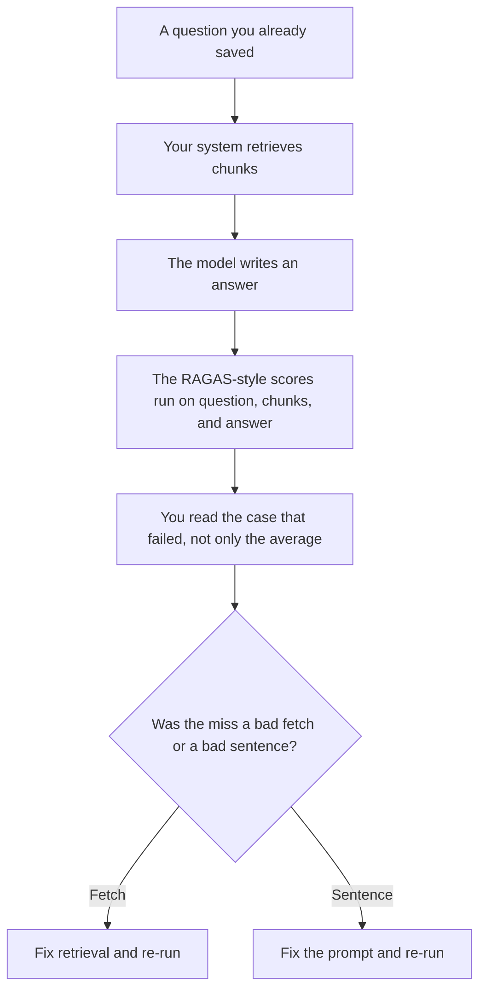

**RAGAS evaluation is a named way to score a retrieval-augmented answer on separate questions: did the sentences stay inside the retrieved text, did the answer address the question, were the retrieved chunks mostly relevant, and did retrieval bring back what the answer needed?** It is a metric recipe, usually run as an open-source library, not a chat product in this directory. The recipe can use a model as a judge. A judge model is not a measurement from this site, and a high score is not permission to skip opening the source.

The method being scored is [what RAG is](/blog/what-is-rag-explained-2026/). The narrower question of whether you fetched the right pages is [what retrieval evaluation is](/blog/what-is-retrieval-evaluation-2026/). The runner that should execute the recipe the same way next month is [what an AI eval harness is](/blog/what-is-ai-eval-harness-2026/). The habit of keeping a fixed set is [what AI eval testing is](/blog/what-is-ai-eval-testing-2026/).

Prices are US list prices excluding tax from directory pages checked October 16, 2026. Published October 24, 2026. The directory does not list a RAGAS subscription, so this page does not invent one. RAGAS is published as open-source evaluation code. We did not run it against any product, and we do not publish a RAGAS score.

## The four questions the recipe is known for

| Score | The question | What you need besides the model's answer |
|---|---|---|
| Faithfulness | Are the claims supported by the retrieved context? | The context the model actually saw |
| Answer relevancy | Does the answer address the question that was asked? | The question |
| Context precision | Are the relevant chunks ranked above the noise? | A judgment of which chunks matter |
| Context recall | Did retrieval include what was required to answer? | A reference: the facts that should have been found |

Context recall is the score people skip because it needs a reference answer or a reference set of facts. Without that reference, you can still talk about faithfulness. You cannot honestly report recall. Say which scores you ran.

A loop that searches again is a different product shape. That pattern is [what agentic RAG is](/blog/what-is-agentic-rag-2026/). The same four questions can still apply to the final context and the final answer. They do not grade the search loop by themselves.

## What you pay for around the score, not for the recipe

**A cited public answer, if the corpus is the web.** [Perplexity](/tools/perplexity/) Pro is $17 a month billed annually. A citation is a link you open. It is not a RAGAS run. The review is [Perplexity review](/blog/perplexity-review-2026/).

**A bot on your help center, which is the system you would score.** [Chatbase](/tools/chatbase/) Hobby is $32 a month billed yearly, or $40 monthly. There is a 7-day trial and no permanent free plan on the card. The directory does not say Chatbase runs RAGAS. If you want the score, you export questions, contexts, and answers and run the recipe yourself. The review is [Chatbase review](/blog/chatbase-review-2026/).

**The place you read a failed case.** [Claude](/tools/claude/) Pro is $20 a month, or $17 billed annually. Paste one failed triple: question, chunks, answer. Ask which claim is unsupported. Do not ask it to "improve the RAGAS number" without showing the case. The review is [Claude review](/blog/claude-review-2026/).

**The log of which score you trust.** [Notion AI](/tools/notion-ai/) Business is $20 a seat a month. Record the library version, the judge model, the date, and the set. A score without those four lines cannot be compared with next month. The invoice is [Notion AI pricing explained](/blog/notion-ai-pricing-explained-2026/).

The vector piece under retrieval has its own page: [what embeddings are](/blog/what-is-embeddings-in-ai-2026/). Changing the embedding model is a retrieval change. Re-run the scores. That comparison to the last passing run is [what prompt regression testing is](/blog/what-is-prompt-regression-testing-2026/).

## How to read a RAGAS number without fooling yourself

Report the metric name, the set size, and the judge model. A faithfulness of "high" with no denominator is not a result. A single average across mixed question types hides the policy questions, which are the ones customers escalate.

Do not tune the prompt until the average goes up and then delete the cases that fell. Those cases are the regression. Do not compare two judge models as if they were the same ruler. If you change the judge, you start a new baseline and you say so.

The check a person still does, one source at a time, is [how to fact-check AI writing](/blog/how-to-fact-check-ai-writing-2026/).

## FAQ

### Is RAGAS a product I can buy in this directory?

No tool page here sells RAGAS as a plan. Treat it as open-source evaluation code you run, or as a recipe a vendor might claim to follow. If a vendor claims a RAGAS score, ask for the set, the date, and the judge model. This site did not verify any such claim.

### Do I need all four scores?

No. Faithfulness and a retrieval label answer different incidents. Pick the score that matches the bug you saw: unsupported sentences, or the right page never retrieved. Name the ones you skipped, especially context recall if you have no reference.

### Can I use RAGAS on a chatbot that does not show sources?

You can try. If you cannot log the context the model saw, faithfulness is a guess. Log the chunks. Then score.

### Does a passing RAGAS run mean the answer is true?

It means the recipe, on that set, with that judge, did not flag the failure you defined. The source page can still be wrong. Open it when the decision matters.

## Last verified

October 16, 2026 for Perplexity, Chatbase, Claude, and Notion. No RAGAS price is recorded in the directory. Published October 24, 2026.

**Sources:** [Perplexity pricing](https://www.perplexity.ai/hub/pricing), [Chatbase pricing](https://www.chatbase.co/pricing), [Claude pricing](https://claude.com/pricing).

*Published by Andrew for [AI Tools Optimizer](https://aitoolsoptimizer.com).*

[Perplexity](/tools/perplexity/) is in the [research and search directory](/tools/category/research-search/). Directory pages may use affiliate links. A purchase through them may earn us a commission at no extra cost to you.
