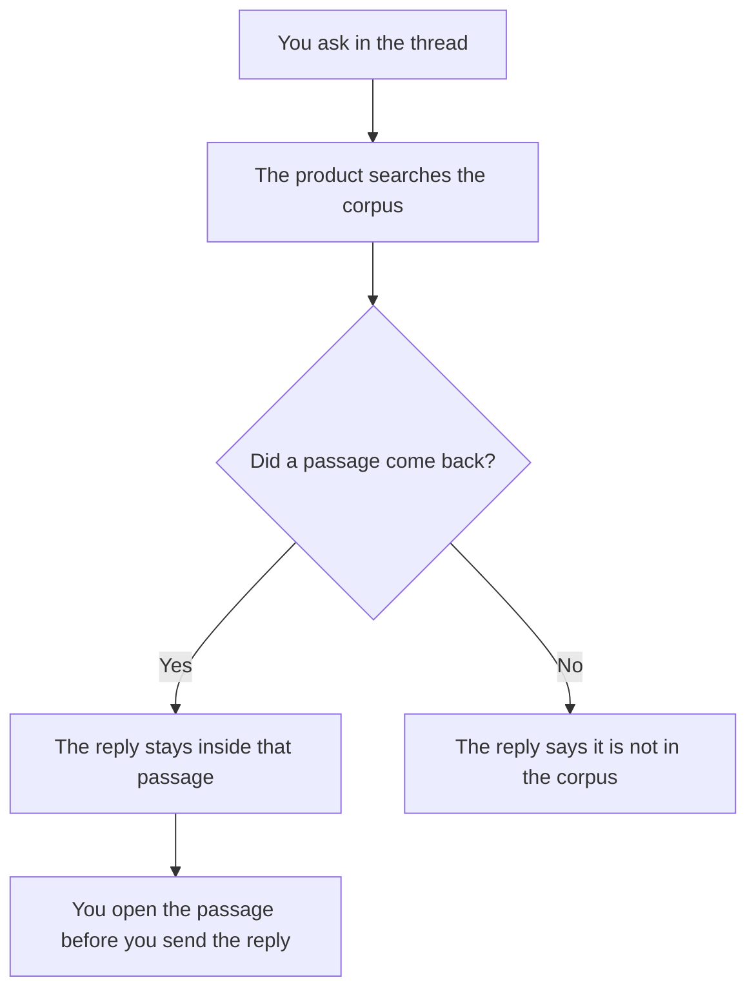

**Retrieval-augmented chat is a conversation where each turn can search a corpus and answer from the passages it just found.** You are still in a chat. The difference from an ordinary reply is that the sentence is supposed to point at a page, a file, or a help article you can open. The method underneath has a name, [what RAG is](/blog/what-is-rag-explained-2026/). This page is the chat habit: follow-up questions, a thread, and a source that has to survive the second turn.

A normal chat writes from the prompt and from training. A retrieval-augmented chat writes from a search that happened for this message. If the product cannot show the passage, you are back in an ordinary chat with a confident tone. The failure mode is [what an AI hallucination is](/blog/what-is-ai-hallucination-2026/).

Prices are US list prices excluding tax from directory pages checked October 16, 2026. Published October 24, 2026. Nothing here is a retrieval score.

## What changes between turns

| Turn | Ordinary chat | Retrieval-augmented chat |
|---|---|---|
| First question | The model answers from the prompt and from training | The system searches, then answers from the hits |
| Follow-up ("what about refunds?") | It continues the thread, and may drift | It should search again, or stay inside the passages already on screen |
| "Where did that come from?" | A citation you cannot open is decoration | A link, a file name, or a help-article title you can open |
| A fact that is only in your head | Paste it, or accept a guess | The corpus has to contain it. The chat will not interview you for a missing policy |

The limit on how much of a long file you can paste yourself is [what a context window is](/blog/what-is-a-context-window-2026/). Retrieval exists so you do not paste the whole help center into turn one.

## Which chat is already doing the search

| The corpus | The chat | Price to know |
|---|---|---|
| The public web, with links | [Perplexity](/tools/perplexity/) | Pro is $17/month billed annually |
| Files you upload for a study session | [Gemini Notebook](/tools/gemini-notebook/) | Free. Higher limits from Google AI Plus at $4.99/month |
| Your Notion workspace | [Notion AI](/tools/notion-ai/) | The full agent experience is on Business at $20/seat/month |
| A help center you uploaded | [Chatbase](/tools/chatbase/) | Hobby is $32/month billed yearly, with 700 message credits |
| A document you paste into the thread | [Claude](/tools/claude/) or any general chat | Claude Pro is $20/month, or $17 billed annually. That is manual retrieval: you brought the passage |

Perplexity's invoice is [Perplexity pricing explained](/blog/perplexity-pricing-explained-2026/). A research workflow that starts from links is [ChatGPT vs Perplexity for research](/blog/chatgpt-vs-perplexity-for-research-2026/). Notion's seat is [Notion AI pricing explained](/blog/notion-ai-pricing-explained-2026/). The support build on uploaded articles is [how to build a support chatbot with Chatbase](/blog/how-to-build-a-chatbot-with-chatbase-2026/).

## How a follow-up goes wrong

**The second turn answers from the first turn's wording, and skips a new search.** You asked about refunds. The model reused a shipping paragraph because the thread was about "orders." Ask it to search again, and require the article title in the reply.

**The passage is right and the sentence adds a number.** The help article says "within 30 days." The chat says "within 30 days, and we refund shipping." Cut the clause that is not in the passage. How close the wording stays to the source is partly [what temperature is](/blog/what-is-temperature-in-ai-models-2026/). A lower temperature is a tighter copy. It still needs the passage.

**The corpus is stale.** Retrieval of last year's policy is a faithful answer to the wrong file. Date the articles you upload. A chatbot on a help center is only current if the help center is.

**You treat the chat as the system of record.** The passage is the record. The chat is a draft of a reply. Send the reply after a person opens the passage, especially when the reader is a customer.

## FAQ

### Is retrieval-augmented chat the same as RAG?

RAG is the method: retrieve, then generate. Retrieval-augmented chat is that method inside a thread, including the follow-up. A one-shot summary of a PDF is RAG. A support agent that answers the next customer question from the same help center is the chat.

### Do I need a vector database to have this?

A product can hide the index. You need the index when you are building the search yourself. The storage idea is [what embeddings are](/blog/what-is-embeddings-in-ai-2026/) and [what a vector database is](/blog/what-is-a-vector-database-2026/). A buyer of Perplexity or Chatbase is paying for the search, and still has to open the hit.

### Can I get this by pasting the file into ChatGPT?

Yes, for one file that fits. That is you doing the retrieval. It stops working when the corpus is a help center, a wiki, or the live web. Paste when the source is short. Use a product that searches when the source is a library.

### Does a citation mean the sentence is true?

It means you have something to open. The sentence can still add a claim the passage does not make. Open it, then keep the sentence.

## Last verified

October 16, 2026 for the plan prices named above. Published October 24, 2026.

**Sources:** [Perplexity Pro](https://www.perplexity.ai/pro), [Notion AI](https://www.notion.com/product/ai), [Chatbase pricing](https://www.chatbase.co/pricing).

*Published by Andrew for [AI Tools Optimizer](https://aitoolsoptimizer.com).*

[Perplexity](/tools/perplexity/) is in the [research directory](/tools/category/research-search/). [Chatbase](/tools/chatbase/) is in the [customer support directory](/tools/category/customer-support/). Directory pages may use affiliate links. A purchase through them may earn us a commission at no extra cost to you.
