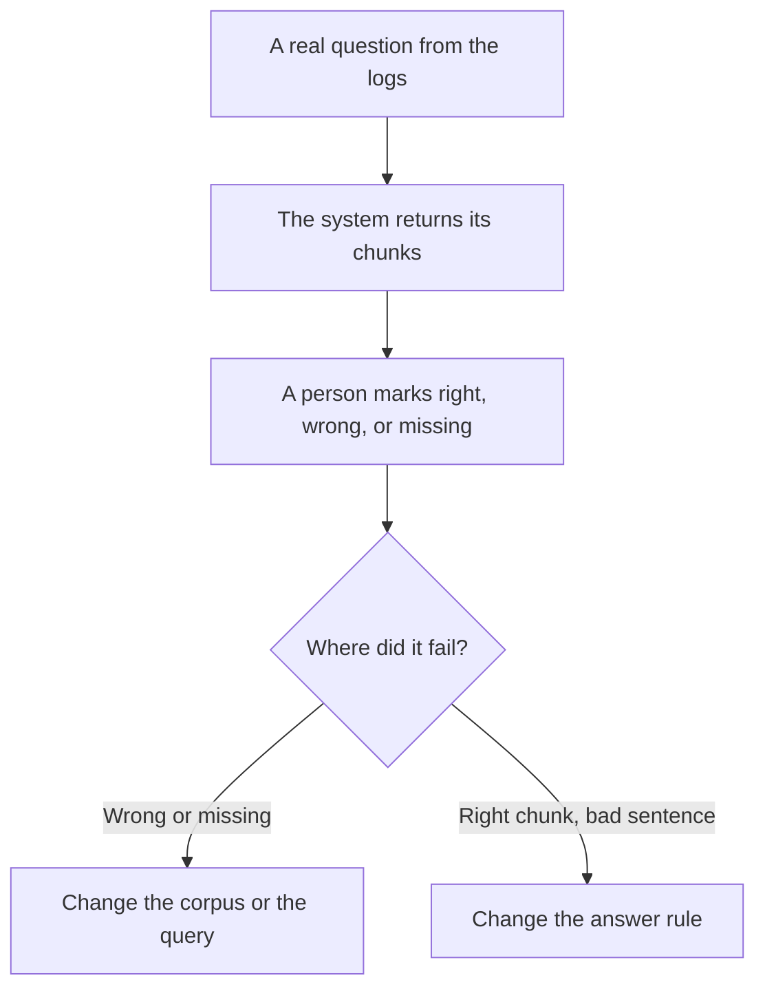

**Retrieval evaluation asks a narrow question: of the pages, chunks, or tickets the system fetched, were they the ones a careful person would have opened for this question?** The model's sentences can be fluent and still rest on the wrong excerpt. Scoring the prose and scoring the fetch are different jobs. This page is the fetch.

The pattern that fetches and then writes is [what RAG is](/blog/what-is-rag-explained-2026/). A chat product that does it in one motion is [what retrieval-augmented chat is](/blog/what-is-retrieval-augmented-chat-2026/). A loop that may search again is [what agentic RAG is](/blog/what-is-agentic-rag-2026/). The broader habit of checking model output is [what AI eval testing is](/blog/what-is-ai-eval-testing-2026/).

Prices below are US list prices from directory pages checked October 16, 2026. Published October 24, 2026. We did not publish a retrieval score for any product.

## What you label

| Label | Meaning | What you do with it |
|---|---|---|
| Right chunk, used | The excerpt supports the sentence, and the answer used it | Keep the example as a passing case |
| Right chunk, ignored | The excerpt was in the set, and the answer wandered off | Fix the prompt or the citation rule, not the index |
| Wrong chunk | A careful reader would not have opened it for this question | Fix the index, the titles, or the query |
| Missing | The answer needed a page that never arrived | Add the page, or teach the bot to say it does not know |

Twenty labeled questions from real tickets will teach you more than a leaderboard number you did not define. Store the labels next to the document version. When the article changes, the old label may be stale. That dependency is [what AI data lineage is](/blog/what-is-ai-data-lineage-2026/).

## Where the corpus lives, and what the seat costs

**Open-web citations you can click.** [Perplexity](/tools/perplexity/) Free cites sources with a weekly cap. Pro is $17 a month billed annually. The card does not print the month-to-month dollar. A retrieval check here is simple: open the citation and see if it says what the answer said. The product page is [Perplexity review](/blog/perplexity-review-2026/). The drafting alternative, when you already hold the file, is [Claude vs Perplexity for research](/blog/claude-vs-perplexity-for-research-2026/).

**A file with page numbers.** [Claude](/tools/claude/) Pro is $20 a month, or $17 billed annually. Ask for the page, then open the page. If the page does not contain the claim, the failure is the answer, not the index. The long-file habit is [Claude vs Gemini for long documents](/blog/claude-vs-gemini-for-long-documents-2026/).

**A handbook the team edits.** [Notion AI](/tools/notion-ai/) Business is $20 a seat a month. If the right page exists and search does not surface it, the title and the headings are part of the system. The card is [Notion AI pricing explained](/blog/notion-ai-pricing-explained-2026/).

**A customer bot.** [Chatbase](/tools/chatbase/) Hobby is $32 a month billed yearly for 700 message credits. Sample real questions, mark the chunks, and fix the articles before you buy a higher tier to "make it smarter." The build is [how to build a knowledge-base chatbot](/blog/how-to-build-a-knowledge-base-chatbot-2026/).

A stored answer for a similar question is a different shortcut, with its own failure mode: [what semantic caching for an LLM is](/blog/what-is-semantic-caching-for-llm-2026/). Do not evaluate a cache hit as if it were a fresh retrieval.

## A small set you can repeat

Pick questions where being wrong costs something: a refund rule, a plan limit, a security step. Hide the model's answer while you mark the chunks, so the prose does not talk you into a pass. Then reveal the answer and mark whether it stayed inside those chunks. Two marks, one row.

The person who can edit the article is the person who can close the loop. A score emailed to a team that cannot change the corpus is a report. The approval on what gets published is [what human-in-the-loop AI is](/blog/what-is-human-in-the-loop-ai-2026/).

## FAQ

### Is retrieval evaluation the same as an answer eval?

The answer eval asks whether the sentences are acceptable. Retrieval evaluation asks whether the evidence in front of the model was the right evidence. You want both. A pretty answer on the wrong page is a failure of the fetch.

### How many questions do we need?

Enough to see a repeated miss, which is often a few dozen from real logs, not thousands. Add a case when a customer hits a new miss. Retire a case when the article it depends on is deleted.

### Can the model grade its own chunks?

It can draft a suggestion. A person who knows the policy confirms the label. A model grading the pages it just retrieved will defend them.

### What if we do not have page numbers?

Then quote the heading and the document id you can open later. A chunk with no id cannot be fixed. Lineage starts with an id.

## Last verified

October 16, 2026 for Perplexity, Claude, Notion, and Chatbase prices named above. Perplexity's month-to-month Pro dollar was not on the card. Published October 24, 2026.

**Sources:** [Perplexity pricing](https://www.perplexity.ai/hub/pricing), [Claude pricing](https://claude.com/pricing), [Notion AI](https://www.notion.com/product/ai).

*Published by Andrew for [AI Tools Optimizer](https://aitoolsoptimizer.com).*

[Perplexity](/tools/perplexity/) is in the [research and search directory](/tools/category/research-search/). Directory pages may use affiliate links. A purchase through them may earn us a commission at no extra cost to you.
