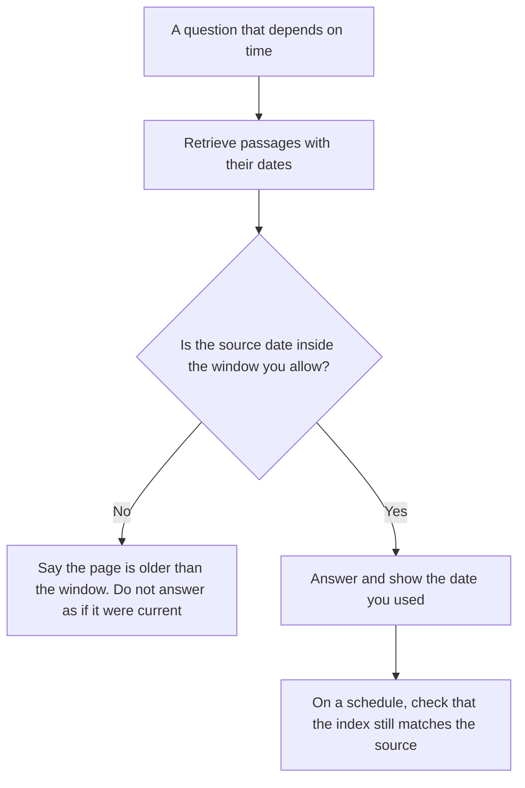

**Retrieval freshness is the gap between the question's clock and the clock on the passage you actually fetched.** A perfect match to a stale page is a fresh-looking wrong answer. Freshness is a date you can point at: when the source changed, when you indexed it, and when the question was asked. A high similarity score does not carry a date.

The pattern of fetching passages before the model writes is [what RAG is](/blog/what-is-rag-explained-2026/). Whether you fetched the right pages at all is [what retrieval evaluation is](/blog/what-is-retrieval-evaluation-2026/). When the same text starts finding different neighbors, that is [what embedding drift is](/blog/what-is-embedding-drift-2026/). The index those neighbors live in is [what a vector database is](/blog/what-is-a-vector-database-2026/).

Prices are US list prices excluding tax from directory pages checked October 16, 2026. Published October 24, 2026. We did not score whose index is newer.

## The three clocks

| Clock | What you record | A failure you can say out loud |
|---|---|---|
| Source updated | The date on the page, the contract, or the row | The model cited a policy that was replaced last quarter |
| Index updated | When your pipeline last ingested that source | The site changed Tuesday. Your index still has Monday |
| Question asked | When the user needed the answer | A "current price" answer from a page with no date |

If the source has no date, the honest line is "undated." Do not let the model write "as of today" because the chat window says today. That habit is [what an AI hallucination is](/blog/what-is-ai-hallucination-2026/).

## Where the stale page enters

**A web answer.** [Perplexity](/tools/perplexity/) Pro is $17 a month billed annually, on the directory card. It is built to show sources. Open the source and read its date before you repeat a price or a policy. The invoice is [Perplexity pricing explained](/blog/perplexity-pricing-explained-2026/). A news watch with the same habit is [Perplexity vs ChatGPT for news monitoring](/blog/perplexity-vs-chatgpt-for-news-monitoring-2026/).

**A file you uploaded.** [Gemini Notebook](/tools/gemini-notebook/) is free with a Google account. It answers from the files in the notebook. Freshness is the date you uploaded, or the date inside the file, whichever you trust. A notebook does not know the file changed on the web unless you replace the file.

**A help center bot.** [Chatbase](/tools/chatbase/) Hobby is $32 a month billed yearly, with 700 message credits. The bot is as fresh as the documents you last trained. A changed refund rule that is not in the doc will be answered from the old doc, confidently. Re-index when the article changes. The build is [how to build a knowledge-base chatbot](/blog/how-to-build-a-knowledge-base-chatbot-2026/).

**A wiki.** [Notion AI](/tools/notion-ai/) Business is $20 a seat a month, the tier with the agent on the directory card. Plus at $10 is not that full AI tier. Put an owner and a review date on the page. A page with no review date is undated, even if the editor autosaved yesterday. The home for that wiki is [how to build an internal wiki with AI](/blog/how-to-build-an-internal-wiki-with-ai-2026/).

Searching again when the first page is weak is [what agentic RAG is](/blog/what-is-agentic-rag-2026/). Another search does not fix a source that is old. It finds more pages. You still compare dates.

## What to do when the date is wrong

Prefer the newer source when both are real and they disagree, and say which one you used. If they disagree and you cannot tell which is current, stop and ask a person. Do not average two prices into a third price.

Re-embed when the source text changes. Re-embedding on a schedule when the text did not change spends compute and can move neighbors. That move is drift. Freshness is the date. Drift is the geometry. Track them as two lines.

## FAQ

### Is freshness the same as relevance?

Relevance is whether the passage is about the question. Freshness is whether it is still true on the clock the question cares about. A relevant stale page is a common production bug. Your eval should include at least one question whose right answer changed.

### How fresh is fresh enough?

Write the window per question type. A refund rule may need to match the article edited this week. A historical quote should stay on the old page, with the old date. One global "max age" will hide both mistakes.

### Can the model see our index time?

Only if you pass it. Put the source date and the index date in the context you show the model, and tell it to repeat them. A date it was not given is a date it may invent.

### Does a vector database store dates for us?

It stores what you put in the record. Add the source timestamp as a field you can filter. A similarity search with no date filter will return the nearest paragraph, including the retired one. The database page covers the index. This page is the clock.

## Last verified

October 16, 2026 for Perplexity, Gemini Notebook, Chatbase, and Notion AI. Published October 24, 2026.

**Sources:** [Perplexity pricing](https://www.perplexity.ai/pro), [Gemini Notebook](https://workspace.google.com/products/gemini-notebook/), [Notion pricing](https://www.notion.com/pricing).

*Published by Andrew for [AI Tools Optimizer](https://aitoolsoptimizer.com).*

[Perplexity](/tools/perplexity/) is in the [research and search directory](/tools/category/research-search/). Directory pages may use affiliate links. A purchase through them may earn us a commission at no extra cost to you.
