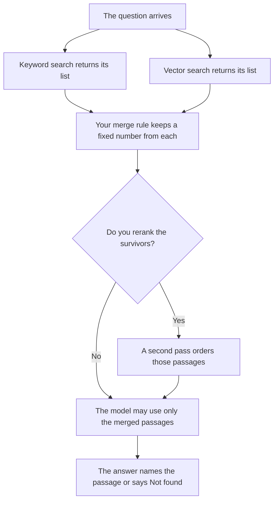

**Retrieval hybrid search runs two lookups on the same question, one by words and one by meaning, then merges the two lists before a model writes an answer.** The keyword list catches the exact name, the error code, and the phrase a customer typed. The vector list catches a question that uses different words for the same page. Hybrid search is the merge. It is the step before the model speaks.

The whole pattern of fetching a page and then answering is [what RAG is](/blog/what-is-rag-explained-2026/). A second pass that reorders passages you already fetched is [what retrieval reranking is](/blog/what-is-retrieval-reranking-2026/). The structure that holds the vectors is [what an embedding index is](/blog/what-is-embedding-index-2026/). The numbers themselves are [what embeddings in AI are](/blog/what-is-embeddings-in-ai-2026/).

Prices are US list prices excluding tax from directory pages checked October 16, 2026. Published October 24, 2026. We did not score which merge returns the right page. A hybrid list can still miss the document, and a fluent answer does not prove the merge worked.

## What each list is for

| List | It wins when | It misses when |
|---|---|---|
| Keyword | The user typed a SKU, an error code, or a proper name that has to match | The question uses none of the words on the page |
| Vector | The question means the same thing with different words | The exact token matters and similar pages outrank it |
| The merge | You wrote how many rows from each list survive, and how ties break | You concatenate both lists and hope the model notices |
| The answer | It quotes a passage that survived the merge | It adds a fact from neither list |

Reranking does not replace the merge. It orders what the merge already kept. If the right page never entered either list, reranking cannot invent it. Whether you fetched the right pages at all is [what retrieval evaluation is](/blog/what-is-retrieval-evaluation-2026/). How new the page is, which is a separate failure, is [what retrieval freshness is](/blog/what-is-retrieval-freshness-2026/).

## Where the two lists show up in a product

**A cited web answer.** [Perplexity](/tools/perplexity/) Pro is $17 a month billed annually. The product returns sources you can open. This page does not claim Perplexity publishes a hybrid-search switch with that name. Use it when the job is to open the page. The invoice is [Perplexity pricing explained](/blog/perplexity-pricing-explained-2026/).

**A long file you already have.** [Claude](/tools/claude/) Pro is $20 a month, or $17 billed annually, when the source is a document in a Project and the question has to stay inside it. A Project is not a search index. If the file is the only source, you do not need a second list. The review is [Claude review](/blog/claude-review-2026/).

**A paste of both result lists.** [ChatGPT](/tools/chatgpt/) Plus at $20 a month can format a merge you already computed: which ids appeared in both lists, which appeared in one. It should not be asked which list was "more relevant" without the rule you wrote. The review is [ChatGPT review](/blog/chatgpt-review-2026/).

**A wiki with titles people search by name.** [Notion AI](/tools/notion-ai/) Business is $20 a seat a month. Exact page titles are a keyword problem. A question phrased in someone else's words is a meaning problem. The seat does not publish your merge rule. You still write how many hits from each method the answer may use.

## What to write down

Write the keyword method, the vector method, how many hits you keep from each, how you break ties, and what the model must do when both lists are empty. Empty means Not found. A merge with no empty case will make the model answer from memory, which is [what an AI hallucination is](/blog/what-is-ai-hallucination-2026/).

## FAQ

### Is hybrid search the same as RAG?

RAG is the pattern: retrieve, then generate. Hybrid search is one way to build the retrieve step, by merging a word list and a meaning list. You can do RAG with only one of those lists. You can merge the lists and still hand the model the wrong pages.

### Do we always need both lists?

Use both when the corpus has exact tokens and paraphrases. A glossary of error codes can be keyword-only. A pile of tickets written five different ways usually wants both. Adding a vector list without a merge rule is two piles, not a hybrid.

### Does reranking make the hybrid step optional?

No. Reranking reorders passages you already retrieved. If you only retrieved the vector list, the keyword hit never arrives for the reranker to promote. Run the list that can catch the exact string, then decide whether to rerank.

### Can the model merge the lists itself?

It can format a merge you defined. It should not invent the weights. If you did not say how many keyword hits must survive, the model will prefer the passage that reads well. Write the counts down and check them on a set of questions you already know the answer to.

## Last verified

October 16, 2026 for Perplexity, Claude, ChatGPT, and Notion AI. Published October 24, 2026.

**Sources:** [Perplexity pricing](https://www.perplexity.ai/pro), [Claude pricing](https://claude.com/pricing), [ChatGPT pricing](https://chatgpt.com/pricing/), [Notion pricing](https://www.notion.com/pricing).

*Published by Andrew for [AI Tools Optimizer](https://aitoolsoptimizer.com).*

[Perplexity](/tools/perplexity/) is in the [research and search directory](/tools/category/research-search/). Directory pages may use affiliate links. A purchase through them may earn us a commission at no extra cost to you.
