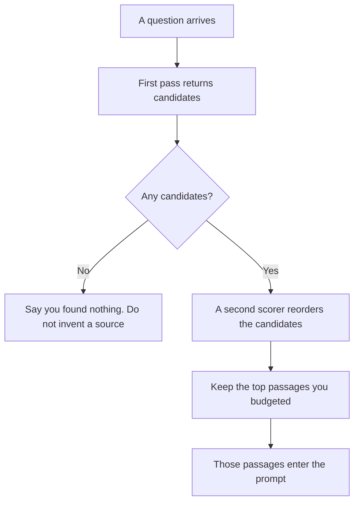

**Retrieval reranking is a second pass that reorders passages you already fetched, using a slower or stricter scorer, before those passages go into the prompt.** The first pass finds candidates quickly. The reranker decides which of those candidates the model should actually see. A page that never entered the first pass cannot be reranked into the answer.

Fetching passages at all is [what RAG is](/blog/what-is-rag-explained-2026/). Whether the page is current is [what retrieval freshness is](/blog/what-is-retrieval-freshness-2026/). How you tell a good fetch from a bad one is [what retrieval evaluation is](/blog/what-is-retrieval-evaluation-2026/). The vectors the first pass usually searches are [what embeddings are](/blog/what-is-embeddings-in-ai-2026/).

Prices are US list prices excluding tax from directory pages checked October 16, 2026. Published October 24, 2026. This page does not inspect any vendor's stack and does not claim they run a reranker. We did not score search quality.

## The two passes

| | First pass | Rerank |
|---|---|---|
| Job | Pull a candidate set from the index | Order that set for the prompt |
| Typical pressure | Cheap enough to scan many chunks | Expensive enough that you only run it on the candidates |
| What it can see | Whatever the index holds | Only what the first pass returned |
| Failure | The right page never appears | The right page was fetched and then buried |
| What you log | The candidate ids | The order you kept, and the order you dropped |
| What you still check | The date on the source | The same date. Rerank does not refresh a stale page |

Reranking spends context. Every passage you keep is tokens the reply cannot use. The split of that window is [what token budgeting is](/blog/what-is-token-budgeting-2026/). A reranker that returns twelve long chunks can crowd out the answer. Cap the count before you admire the order.

## Products that retrieve, and what this page will not claim

**Cited answers.** [Perplexity](/tools/perplexity/) puts citations on answers. Pro is $17 a month billed annually. A citation means you can open a source. It does not tell you whether a reranker ordered those sources. Open the link and note the date. The research habit is [how to use Perplexity for market research](/blog/how-to-use-perplexity-for-market-research-2026/). The review is [Perplexity review](/blog/perplexity-review-2026/).

**A bot on your articles.** [Chatbase](/tools/chatbase/) trains an agent on sources you supply. Hobby is $32 a month billed yearly, with 700 message credits. If the right article is missing from the sources, no second pass will find it. Add the article. Then ask whether your plan's retrieval order matches the question. The directory does not document a rerank control, so this page does not invent one.

**Literature, with papers attached.** [Elicit](/tools/elicit/) is a research tool in this directory. Use it when the candidates should be papers, and still read the paper. A ranked list of abstracts is a first pass you can see. Treat any "top" label as an order to review, and keep the judgment with the person who will cite the work.

**The wiki you already have.** [Notion AI](/tools/notion-ai/) Business is $20 a seat a month and can search connected apps. The page of record still needs an owner. A rerank inside a vendor's search is their implementation. Your job is to notice when the passage in the draft is the wrong page from a set you could have checked.

## What to log if you build the second pass

Log the query, the candidate ids from the first pass, the ids you kept after rerank, and the date on each source. When an answer is wrong, you can see whether the page was missing or merely buried. Evaluation needs that distinction. Freshness needs the date. Rerank needs the before-and-after order.

Do not add a reranker to hide a bad index. If the first pass never returns the right page, fix the index, the chunking, or the source list. A second scorer cannot retrieve a document it was not given.

## FAQ

### Is reranking the same as the model's answer?

The reranker orders sources. The model writes from the sources you kept. A fluent answer can still cite the passage you ranked second and ignore the one you ranked first. Read both.

### Does a higher similarity score mean we reranked?

A similarity score is usually the first pass. Reranking is a separate order on top of those scores. One score, with no second list, is one pass.

### Will reranking fix stale prices?

It will prefer a passage that looks more relevant. It will not update the passage. Check the date. A fresh wrong page can outrank a stale right one, and the reverse happens too.

### Should every search box have a reranker?

Add one when you can show that the right page is in the candidate set and still loses. If it is absent, spend the effort on the first pass. If you cannot log the order, you cannot tell which problem you have.

## Last verified

October 16, 2026 for Perplexity, Chatbase, and Notion AI. No vendor on this page is credited with a specific reranker. Published October 24, 2026.

**Sources:** [Perplexity Pro](https://www.perplexity.ai/pro), [Chatbase pricing](https://www.chatbase.co/pricing), [Notion pricing](https://www.notion.com/pricing).

*Published by Andrew for [AI Tools Optimizer](https://aitoolsoptimizer.com).*

[Perplexity](/tools/perplexity/) is in the [research and search directory](/tools/category/research-search/). Directory pages may use affiliate links. A purchase through them may earn us a commission at no extra cost to you.
