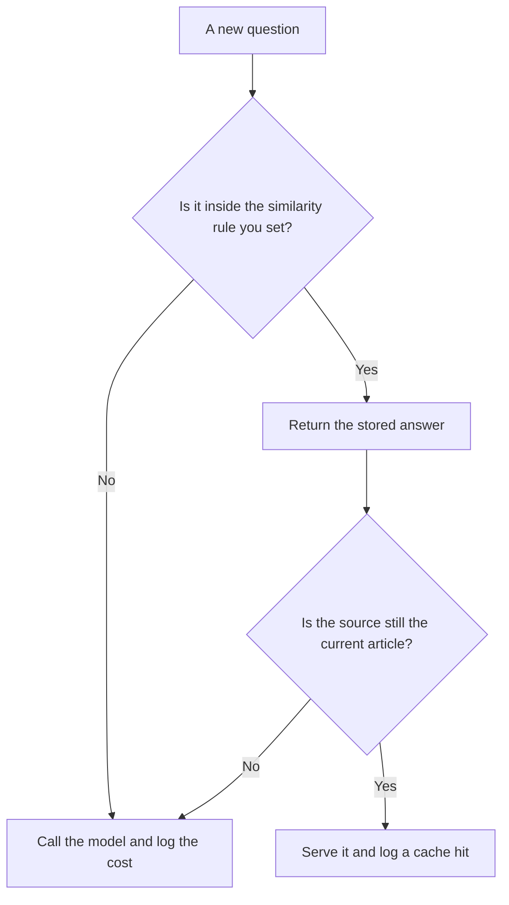

**Semantic caching stores a question and the answer you already accepted, then returns that answer when a new question is close enough in meaning that you are willing to skip a new model call.** "Close enough" is the whole design. A prefix cache needs the same bytes. A semantic cache needs a similarity rule and a person who decided what a wrong hit costs.

The byte-match version is [what prompt caching is](/blog/what-is-prompt-caching-2026/). The unit you skip paying for is [what AI tokens are](/blog/what-are-ai-tokens-explained-2026/). A wrong answer that sounds fluent is [what an AI hallucination is](/blog/what-is-ai-hallucination-2026/). The ledger those skipped calls should still appear on, as a saved line or a zero, is [what AI cost attribution is](/blog/what-is-ai-cost-attribution-2026/).

Prices below are US list prices from directory pages checked October 16, 2026. Published October 24, 2026. The directory does not list a semantic-cache product fee, so this page does not invent one. We did not measure hit rates.

## A hit you can defend

| Situation | A semantic cache can be reasonable | Leave the cache off |
|---|---|---|
| The same help question, reworded, against an article that has not changed | You stored the approved answer and the article id | The article was edited yesterday and the cache still holds the old steps |
| A greeting or a status phrase | The cost of a model call is silly | The phrase includes an account number |
| Two questions that share words and differ in the number | The similarity score will look high | "30 days" and "60 days" are different policies |
| A private customer fact | You would be serving one customer's answer to another | Always, unless the cache key includes that customer and your privacy review allows it |

Similarity is not truth. A cached answer can be stale, over-broad, or from a different product tier. Expire the entry when the source changes. That dependency is [what AI data lineage is](/blog/what-is-ai-data-lineage-2026/).

## What this site can price, and what it cannot

**The model call you hope to skip.** [ChatGPT](/tools/chatgpt/) Plus is $20 a month for a person. An API bill is separate. Business is $20 a user a month billed annually for two or more users. A semantic cache in front of a support bot saves API calls only if you run one. A Plus seat does not become cheaper because two employees asked similar questions. The ladder is [ChatGPT Go vs Plus vs Pro](/blog/chatgpt-go-vs-plus-vs-pro-2026/).

**A second drafting seat.** [Claude](/tools/claude/) Pro is $20 a month, or $17 billed annually. Use it to write the approved answer you will store. Do not ask it to decide the similarity threshold. That number is an engineering choice you can explain. The review is [Claude review](/blog/claude-review-2026/).

**A cited lookup that should stay fresh.** [Perplexity](/tools/perplexity/) Pro is $17 a month billed annually. A news question should not be served from last month's cache. The research choice is [Claude vs Perplexity for research](/blog/claude-vs-perplexity-for-research-2026/).

**A bot on your articles.** [Chatbase](/tools/chatbase/) Hobby is $32 a month billed yearly for 700 message credits. A cache in front of that bot is your architecture, not a line on Chatbase's card. If the article changes, the stored reply has to change with it. The build is [how to build a knowledge-base chatbot](/blog/how-to-build-a-knowledge-base-chatbot-2026/).

## Rules that keep a cache boring

Key the cache by the source version, the product, and the audience. Do not key it by the question alone. Set a maximum age. Log hits and misses next to the dollars you did not spend, so finance can see a real line. When the cost of a wrong answer is a refund, a legal claim, or a customer email, skip the cache and call the model, then a person. The approval habit is [what human-in-the-loop AI is](/blog/what-is-human-in-the-loop-ai-2026/).

A prompt cache and a semantic cache can sit in the same system. They answer different misses. Document which one fired. A dashboard that says only "cached" will hide a stale policy.

## FAQ

### Is a high similarity score enough to reuse an answer?

Only if you also checked that the source version matches and the audience matches. A score without those keys will serve the wrong policy with confidence.

### Does semantic caching replace retrieval?

It replaces a model call when you already accepted an answer for that kind of question. The first time, you still retrieve and you still read. The measurement of those chunks is [what retrieval evaluation is](/blog/what-is-retrieval-evaluation-2026/).

### Can I cache answers that include personal data?

Only under the privacy rule for that data, and only with a key that cannot leak one person to another. When in doubt, do not store it. A savings line is not a reason to widen access.

### Should the model pick the threshold?

No. A person sets the threshold from a labeled set of near-misses your team created from real tickets, with the bad pairs marked by hand. The model does not grade its own reuse.

## Last verified

October 16, 2026 for ChatGPT, Claude, Perplexity, and Chatbase prices named above. No semantic-cache vendor fee is recorded in the directory. Published October 24, 2026.

**Sources:** [ChatGPT pricing](https://chatgpt.com/pricing), [Claude pricing](https://claude.com/pricing), [Chatbase pricing](https://www.chatbase.co).

*Published by Andrew for [AI Tools Optimizer](https://aitoolsoptimizer.com).*

[ChatGPT](/tools/chatgpt/) is in the [chatbots and assistants directory](/tools/category/chatbots-assistants/). Directory pages may use affiliate links. A purchase through them may earn us a commission at no extra cost to you.
