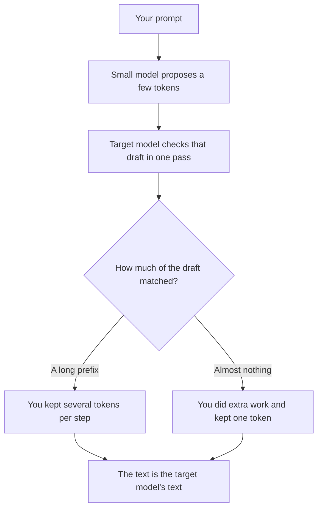

**Speculative decoding drafts the next tokens with a small, fast model, then lets the model you actually trust accept or reject that draft in one pass.** The goal is a shorter wait for one answer. When the check is done the usual way, the text you keep is the text the large model would have produced. You did not switch products. You changed how the tokens were proposed.

The wait it tries to shrink is [what AI latency is](/blog/what-is-ai-latency-vs-throughput-2026/). The pieces being drafted are [what AI tokens are](/blog/what-are-ai-tokens-explained-2026/). The large model and the draft model are both doing [inference](/blog/what-is-ai-inference-vs-training-2026/), not training.

Published October 24, 2026. Vendors sometimes advertise a speedup. This page does not reprint one, and it does not score quality.

## What has to be true for the trick to help

| Piece | Its job | If it fails |
|---|---|---|
| Draft model | Propose several next tokens quickly | A bad guess wastes the proposal |
| Target model | Accept a prefix of that draft, or reject it | This is the model whose answers you wanted |
| A match rule | Keep only what the target model agrees with | Skip the rule and you have shipped the draft, which is a different product |
| Spare compute | Run the draft beside the target | A machine that is already full may get slower, not faster |
| Your prompt | Stay the prompt you meant to send | A shorter prompt can beat a clever decoder |

The win shows up when the draft is often right. Code with a repetitive shape, or a phrase the model was going to write anyway, is the friendly case. A prompt where the next token is genuinely uncertain is the unfriendly case. The target model rejects the guess, and you paid for a draft that did not stick.

## What it is not

**It is not quantization.** Quantization stores the same model in fewer bits. Speculative decoding adds a second model that only proposes. You can quantize a model and also speculate. They are different levers. The bit-width lever is [what quantization is](/blog/what-is-quantization-in-ai-2026/).

**It is not distillation.** Distillation trains a smaller model to imitate a larger one, and then you serve the smaller model as the product. A speculative draft model may have been trained that way, but the user-facing model is still the target. If you wanted the small model to be the answer, you wanted [what model distillation is](/blog/what-is-model-distillation-2026/).

**It is not a longer context window.** Nothing about a draft token raises how much you can paste. The limit is [what a context window is](/blog/what-is-a-context-window-2026/).

**It is not a cache.** A [context cache](/blog/what-is-a-context-cache-2026/) reuses a prefix you already sent. Speculative decoding proposes tokens you have not accepted yet. A cached prompt can still be decoded speculatively. The invoice lines are different.

## Where you would meet it in this directory

You usually do not buy "speculative decoding" as a seat. It sits inside a vendor's serving stack, or in an inference server you run. The name on the invoice stays the model name.

[DeepSeek](/tools/deepseek/) is the API in this directory with a public token card, not a public latency card. Flash input on a cache miss is $0.15 per million tokens off-peak. That price does not tell you whether the serving path drafts tokens ahead. Read [DeepSeek review](/blog/deepseek-review-2026/) for the bill. Time your own call if the wait is the issue.

[ChatGPT](/tools/chatgpt/) Plus at $20 and [Claude](/tools/claude/) Pro at $20, or $17 billed annually, are usage plans. Neither plan page, as recorded here, sells a speculative-decoding toggle. If a reply feels slow, time the first token and the tool calls before you change plans. The trace habit is [what AI observability is](/blog/what-is-ai-observability-2026/).

[GitHub Copilot](/tools/github-copilot/) Free includes 2,000 completions a month. Pro is $10. A completion is a short draft by product design. That product fact is not a statement that the serving stack uses speculative decoding. The seat is [GitHub Copilot pricing explained](/blog/github-copilot-pricing-explained-2026/).

The architecture underneath the target model, if you need the picture, is [what a transformer model is](/blog/what-is-a-transformer-model-2026/).

## FAQ

### Does speculative decoding change the answer?

The standard design keeps the target model's answer and throws away draft tokens the target model rejects. A vendor that skips the check has shipped the draft model. Ask which model is allowed to commit a token before you quote a speedup.

### Will it help a saturated batch?

Often less. The technique spends extra draft compute to shorten one sequence. When the hardware is already full of batch work, that extra compute has nowhere to sit. Latency and throughput pull apart here. Measure the path you actually run.

### Can I turn it on in ChatGPT?

Nothing recorded on the Plus or Pro cards in this directory is that switch. Assume it is an internal serving choice unless a setting says otherwise.

### Should I pick a model because a blog claimed a 2× speedup?

No. A speedup from someone else's prompt, hardware, and draft model is not your number. This page intentionally has no speedup in it. Time a prompt you send every day.

## Last verified

October 16, 2026 for ChatGPT, Claude, Copilot, and DeepSeek list prices used as orientation. The definition does not depend on those prices. Published October 24, 2026.

**Sources:** [DeepSeek API docs](https://api-docs.deepseek.com/), [GitHub Copilot plans](https://github.com/features/copilot), [Claude pricing](https://claude.com/pricing).

*Published by Andrew for [AI Tools Optimizer](https://aitoolsoptimizer.com).*

[Claude](/tools/claude/) is in the [chatbots and assistants directory](/tools/category/chatbots-assistants/). Directory pages may use affiliate links. A purchase through them may earn us a commission at no extra cost to you.
