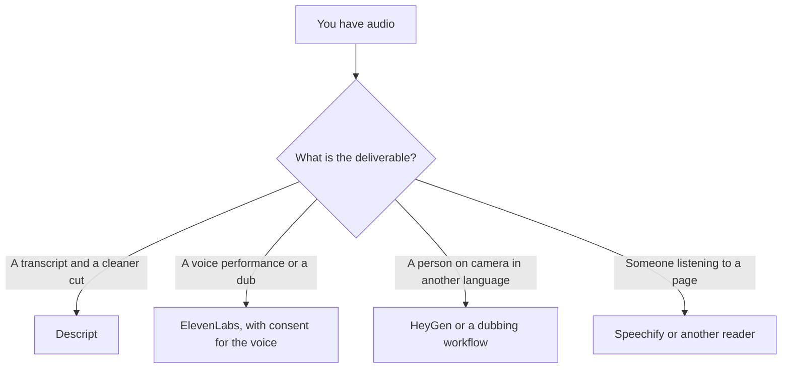

**Speech-to-speech AI takes spoken audio in and returns spoken audio out.** The product may convert a voice, translate speech, or hold a live conversation. A transcript can exist in the middle. The thing you came for is the sound, not the document.

That is a different job from text-to-speech, which starts from words you typed, and from speech-to-text, which stops at the transcript. Products often chain those two and call the result speech-to-speech. The chain is real. The risks are the transcript's mistakes plus the voice's mistakes. Models that handle more than one kind of input are [what multimodal AI is](/blog/what-is-multimodal-ai-2026/).

Published October 24, 2026. We did not score voice likeness.

## Four products that all touch audio

| Job | What goes in | What comes out | A tool in the directory |
|---|---|---|---|
| Read a document aloud | Text | A voice | [Speechify](/tools/speechify/). This is text-to-speech, not speech-to-speech |
| Change or perform a voice from audio | Speech | Speech in another voice | [ElevenLabs](/tools/elevenlabs/), which also sells text-to-speech, cloning, and dubbing |
| Dub a video into another language | Speech, often with a picture | Speech, and sometimes a new mouth movement | ElevenLabs dubbing, or [HeyGen](/tools/heygen/) when the deliverable is a presenter on screen |
| Talk to an agent | Live speech | Live speech, plus a tool call | ElevenLabs agents. A support bot that only types is a different product |
| Edit a recording you already made | Speech that becomes a transcript | A new audio edit | [Descript](/tools/descript/). You edit text, then the audio follows |

The side-by-side on studio voices is [Murf vs ElevenLabs](/blog/murf-vs-elevenlabs-2026/). The credit ladder is [ElevenLabs pricing explained](/blog/elevenlabs-pricing-explained-2026/). A video that has to ship in another language is [how to localize video with AI](/blog/how-to-localize-video-with-ai-2026/).

## What you are paying for

ElevenLabs prices credits, not "speech-to-speech" as its own seat. On the directory page checked October 16, 2026: Free is 10,000 credits a month and has no commercial license. Starter is $6 a month with 30,000 credits and a commercial license. Creator is $22 with 121,000 credits and professional voice cloning. Pro is $99, Scale is $299, and Business is $990. First-month discounts are common. Tax sits outside those list prices. The review is [ElevenLabs review](/blog/elevenlabs-review-2026/).

[Murf](/tools/murf-ai/) is the other studio voice in that comparison. Its directory card, also October 16, prices the API from $0.01 per 1,000 characters and points studio plans at the pricing page. A character rate is text-to-speech math. If your input is audio, confirm the product converts speech, or budget the transcript step separately.

[Descript](/tools/descript/) Hobbyist is $16 per person per month billed annually on the October 16 card. You use it when the recording exists and the work is cutting filler, which is [how to remove filler words with Descript](/blog/how-to-remove-filler-words-with-descript-2026/). That workflow is speech to text to a new audio file. It is the right tool for a podcast. It is the wrong tool for a live agent.

[HeyGen](/tools/heygen/) Creator is $29 a month on the customer-success roundup's October 16 figure. Use it when the output is a person on screen. The training-video comparison is [Synthesia vs HeyGen for training](/blog/synthesia-vs-heygen-for-training-2026/).

Speechify is the reader. If the job is "listen to this article," you do not need a speech-to-speech model. The voice roundup is [best AI voice generators](/blog/best-ai-voice-generators/).

## Consent, latency, and the transcript in the middle

A cloned voice needs permission from the person whose voice it is. ElevenLabs gates professional cloning to Creator and above on the October 16 card. A plan price is not consent. Keep the recording rights next to the export.

Live speech-to-speech adds latency. A chain that transcribes, thinks, and speaks will pause. A model that maps audio toward audio can pause less and can also skip a transcript you needed for a record. Support and sales calls still want the transcript. Capture it on purpose. The notes products for meetings are a different aisle: [how to summarize meetings with AI](/blog/how-to-summarize-meetings-with-ai-2026/).

If a step in the middle is a text model, that step can invent. Listen to the export against the source. A fluent voice does not make a wrong sentence true.

## FAQ

### Is speech-to-speech the same as a voice agent?

A voice agent is speech-to-speech plus a job: answer from a help center, book a meeting, refuse what it should not do. The audio path is necessary. The policy and the tools are the product. Those checks are [what AI guardrails are](/blog/what-is-ai-guardrails-2026/).

### Do I need speech-to-speech to dub a video?

You need a path from the original speech to new speech, and a picture that matches. Dubbing tools hide the transcript. You should still read the new lines before you publish, especially for a price or a promise.

### Why would I use text-to-speech instead?

When the source of truth is a script. Write the script, then generate the voice. You will spend less time correcting a transcription of a rough take. [Murf vs ElevenLabs](/blog/murf-vs-elevenlabs-2026/) is that purchase.

### Does a meeting notetaker do this?

It turns speech into notes. The deliverable is text. Use a notetaker when you need the decision. Use speech-to-speech when you need new audio.

## Last verified

October 16, 2026 for ElevenLabs, Murf, Descript, and the HeyGen Creator figure cited from the customer-success roundup's directory check. Published October 24, 2026.

**Sources:** [ElevenLabs pricing](https://elevenlabs.io/pricing), [Descript pricing](https://www.descript.com/pricing).

*Published by Andrew for [AI Tools Optimizer](https://aitoolsoptimizer.com).*

[ElevenLabs](/tools/elevenlabs/) is in the [audio directory](/tools/category/audio-voice-music/). Directory pages may use affiliate links. A purchase through them may earn us a commission at no extra cost to you.
