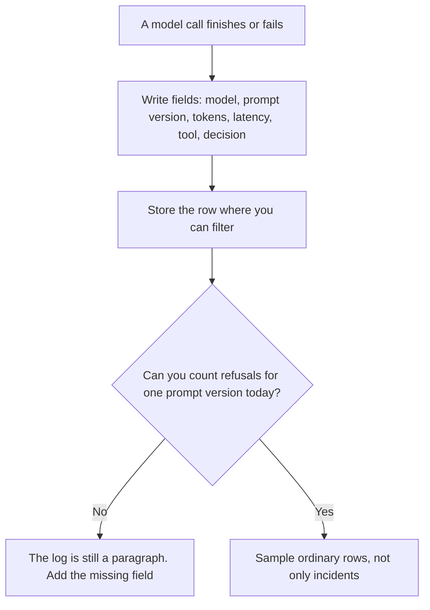

**Structured logging for AI means each model call is stored as named fields, not as a blob of text you grep later.** A useful record can answer, with a filter: which model, which prompt version, how many tokens, how long it took, which tool ran, and whether you refused it. A paragraph in a chat transcript cannot answer those questions for a day of traffic.

The wider habit of opening one bad answer is [what AI observability is](/blog/what-is-ai-observability-2026/). The count that should appear as its own field when you refuse a caller is [what AI rate limiting is](/blog/what-is-ai-rate-limiting-2026/). The field that should name the backup model, when you swapped, is [what AI fallback routing is](/blog/what-is-ai-fallback-routing-2026/).

Prices are US list prices excluding tax from directory pages checked October 16, 2026. Published October 24, 2026. The directory does not list a logging-vendor fee, so this page does not invent one. We did not audit any vendor's log format.

## Fields worth a column

| Field | Why you filter on it | A blob that fails the filter |
|---|---|---|
| Model id | A regression started when this id changed | "The AI replied" |
| Prompt version | You can separate a prompt bug from a model bug | The full prompt pasted into a sentence |
| Input and output tokens, or credits | Cost per feature, not per vendor | The monthly invoice |
| Latency | Time to first token and time to done, separately | "It felt slow" |
| Tool name and status | A failed tool is a different incident from a rude answer | The final paragraph only |
| Decision | Allowed, refused, shed, or fell back | An HTTP 500 for all of them |

Keep the prompt text if policy allows, in a field of its own, with a retention date. Do not require an engineer to reconstruct the prompt from a summary. A secret in that field is now in the log. Strip keys before you write the row. The fence around what the model may do is [what AI guardrails are](/blog/what-is-ai-guardrails-2026/).

## What a chat seat will not do for you

A product chat is a transcript. It is not a warehouse of fields. Use it to draft the field list. Export the operational record somewhere you can count.

| Job | Tool | What the card supports | What it does not replace |
|---|---|---|---|
| Draft the field list from an incident you paste | [Claude](/tools/claude/) Pro at $20 a month, or $17 billed annually | A Project for the schema note | The production log |
| A shared note about which fields are required | [ChatGPT](/tools/chatgpt/) Business at $20 a user a month billed annually, minimum two | Admin controls. No training on business data by default | A queryable store |
| Count an export you already have | [Hex](/tools/hex/) Professional at $36 an editor a month. Team at $75 adds schedules and alerts | A notebook on rows you loaded | Capture of the call itself |
| File a ticket when a field shows a refusal spike | [Make](/tools/make/) Core at $9 a month billed annually for 10,000 credits | A side workflow | The row |
| An API you call yourself, which you can log | [DeepSeek](/tools/deepseek/) API input from $0.15 per 1 million tokens off-peak on a cache miss | A token rate you can put in the cost field | A logger |

The schedule that tells you yesterday's export arrived is a data-ops job: [best AI tools for data ops](/blog/best-ai-tools-for-data-ops-2026/). Hex's plan split is [Hex pricing explained](/blog/hex-pricing-explained-2026/).

If you cannot name the prompt version, you cannot canary it. The rollout that depends on this field is [what an AI canary release is](/blog/what-is-ai-canary-releases-2026/).

## What to leave out

Leave out the customer's full document if the question only needed a paragraph, unless retention rules say you must keep it. Leave out a "helpfulness" score you have not defined. A number with no rubric will be managed. The rubric is an eval. The log is the evidence the call happened.

A free-text "notes" field is allowed for the human who handled the exception. It is not a substitute for the decision field. If the decision is only in the notes, you cannot count it.

## FAQ

### Is a JSON line enough?

Yes, if the keys are stable. The format is less important than the promise that `model` means the model id every time. A spreadsheet with those columns is enough at small volume. The failure is a paragraph.

### Do I log the full prompt?

Log the version always. Log the text when you are allowed to, and when you will actually open it. A prompt you are not allowed to store should be hashed or omitted, and the version id should still be there. Policy decides. The model does not.

### Can I reconstruct fields from the chat later?

Sometimes, for one incident, by hand. You cannot reconstruct a day of token counts from memory. Write the fields when the call returns.

### Does observability require a separate vendor?

It requires the fields and a place to filter them. A vendor can be that place. A table you already run can be that place. A chat window is not that place. Start from the fields. Buy a product when the table stops answering the filter.

## Last verified

October 16, 2026 for the prices named above. Published October 24, 2026. Definitions do not depend on a price change.

**Sources:** [Claude pricing](https://claude.com/pricing), [ChatGPT pricing](https://chatgpt.com/pricing/), [Hex pricing](https://hex.tech/pricing/).

*Published by Andrew for [AI Tools Optimizer](https://aitoolsoptimizer.com).*

[Hex](/tools/hex/) is in the [data and analytics directory](/tools/category/data-analytics/). Directory pages may use affiliate links. A purchase through them may earn us a commission at no extra cost to you.
