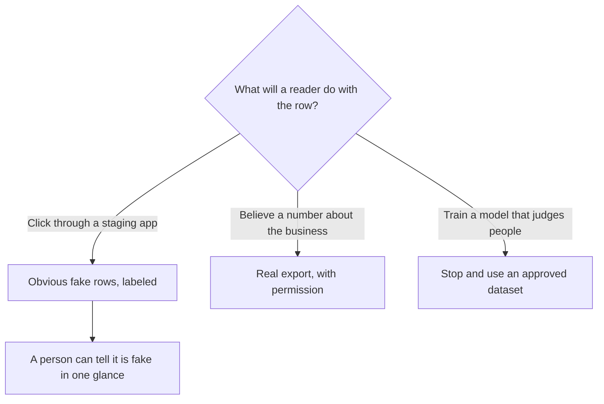

**Synthetic data is data a program or a model generates so you can build or test without using real records.** A fake ticket, a fake order row, or a simulated camera path can be the right input for a demo and the wrong input for a claim about customers. The test is whether a person could mistake the fake row for a fact. If they could, label it, or do not use it.

This page is the buyer's distinction. It is a definition and a usage boundary. Generating a realistic stand-in for a private customer file, a medical image, or anyone's identity is a different project from filling a staging database with obvious test rows. Keep the project on the obvious side unless your counsel has already approved a documented process.

Prices are US list prices excluding tax from directory pages checked October 16, 2026. Published October 24, 2026.

## When a fake row is the right tool

| Need | Synthetic data fits | Use the real source |
|---|---|---|
| A staging inbox so a developer can test a form | Yes. Names like "Test User," amounts you invented, a banner that says STAGING | When the test is "does the real import match finance?" |
| A prompt example that shows a format | Yes, if the example is labeled as an example | When the model is supposed to answer from a policy |
| A chart in a sales demo | Only with a visible "sample data" label | When the chart will be read as this quarter's revenue |
| Training a model on your customers | A high-risk substitute for consent and for real distribution | When the decision affects a person, use an approved real dataset or do not train |
| Filling a help-center bot so it "knows" refunds | The bot will recite the fiction | The help article is the corpus. See [how to build a knowledge-base chatbot](/blog/how-to-build-a-knowledge-base-chatbot-2026/) |

A model trained further on examples is [what fine-tuning is](/blog/what-is-fine-tuning-ai-2026/). Synthetic examples can tilt that training toward whatever bias you baked into the generator. They do not recreate the awkward cases your real tickets have.

## A safe pattern for test data

**1. Decide the question the test answers.** "Does the column map?" is a schema test. Fake rows answer it. "What did customers say about shipping?" is an empirical question. Fake rows answer it with fiction.

**2. Make the fake obvious.** Use a reserved domain, a name prefix like `test-`, and amounts that are round and implausible. A synthetic row that looks like a real customer is how a demo screenshot becomes a quote in a deck.

**3. Generate the shape with a model if you want variety, and mark every row.** [ChatGPT](/tools/chatgpt/) Plus is $20/month. [Claude](/tools/claude/) Pro is $20/month, or $17 billed annually. Ask for 20 rows with `record_type = synthetic` in every line, and with no real addresses. Then open the file and search for anything that looks like a real person. [Julius](/tools/julius-ai/) Plus, at $20/month or $16 billed annually, is the place to inspect a table you already have, and a poor place to launder a production export into a "sample."

**4. Keep synthetic sets out of the production index.** A [Chatbase](/tools/chatbase/) agent trained on fake refund rules will tell customers the fake rule. The message-credit bill is real. The policy is not. Hobby is $32/month billed yearly. Train it on the help center.

**5. Never present a synthetic quote as a customer.** The writing failure is the same shape as [an AI hallucination](/blog/what-is-ai-hallucination-2026/): a sentence with no source. Label sample charts in the slide title, not in a footnote.

## What vendors mean when they say it

Some product pages use "synthetic data" for simulated environments, including video world models used to test a system. Runway's directory entry, checked October 16, 2026, describes its General World Models work as including synthetic data generation for simulation. That is a lab and product direction. It is a separate purchase from a Standard video plan at $12/month billed annually, which buys generation credits for clips. The credit math is [Runway pricing explained](/blog/runway-pricing-explained-2026/). Do not read a video-plan invoice as a license to fabricate customer evidence.

| Phrase on a page | Read it as |
|---|---|
| "Sample data" in a template | A demo, if the label stays on the screen |
| "Synthetic data" for a simulation product | A generated stand-in for a sensor or a scene. Confirm what the contract allows you to claim |
| "Generated examples" in a prompt tutorial | Few-shot format, labeled. See [what few-shot prompting is](/blog/what-is-few-shot-prompting-2026/) |
| "AI-generated customer insights" | A draft until each insight points at a real ticket or a real call |

## FAQ

### Is synthetic data anonymous real data?

No. Anonymous real data started as real records and was altered. Synthetic data was generated. A bad anonymization can still identify someone. A realistic synthetic set can also be reverse-engineered toward the real records it was meant to imitate. Obvious test rows avoid both problems. Realistic imitation of a private dataset needs a review this page cannot replace.

### Can I use ChatGPT to make a fake dataset for a class project?

Yes, when the assignment wants a table to practice on, you label it synthetic, and you do not upload anyone's real grades or contacts as the seed. Ask for implausible names and a `synthetic` column. Check the file before you share it.

### Will synthetic tickets make my support bot better?

They will make it fluent at the tickets you imagined. They will miss the wording your customers actually use. Test on real tickets that a person has permission to use, in a staging bot, and train the live bot on the help center.

### Does a chart built on synthetic data belong in a board deck?

Only as a picture of the product, with the label in the title. A board number comes from the ledger. A generated chart that looks like the ledger is how a demo becomes a report.

## Last verified

October 16, 2026 for ChatGPT, Claude, Julius, Chatbase, and Runway prices, and for the Runway directory note on world models. Published October 24, 2026.

**Sources:** [OpenAI ChatGPT pricing](https://openai.com/chatgpt/pricing/), [Julius AI pricing](https://julius.ai/pricing), [Runway pricing](https://runway.com/pricing).

*Published by Andrew for [AI Tools Optimizer](https://aitoolsoptimizer.com).*

[Julius](/tools/julius-ai/) is in the [data and analytics directory](/tools/category/data-analytics/). Directory pages may use affiliate links. A purchase through them may earn us a commission at no extra cost to you.
