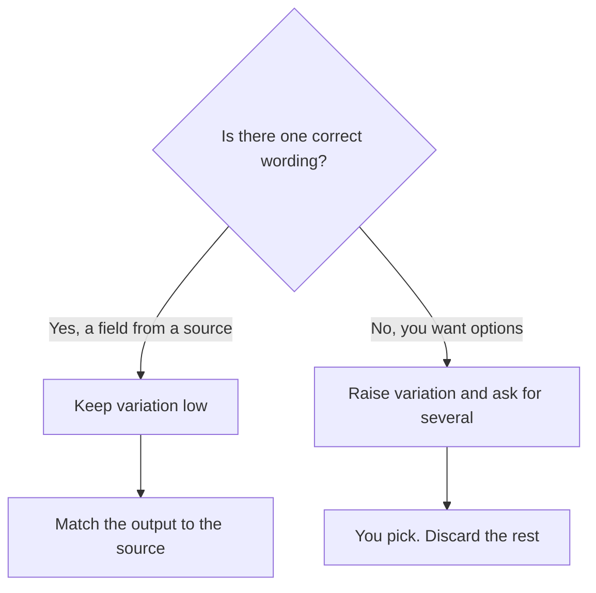

**Temperature is a setting that changes how much the model's next-word choices vary.** Lower temperature sticks closer to the most likely wording. Higher temperature allows less likely wording, which reads as more variety and, past a point, as noise. It does not add knowledge, and it does not check a fact.

Most chat products hide the number. You meet it as a slider, a "creative" mode, or an API parameter. This page does not publish a default temperature for ChatGPT, Claude, or Gemini, because the directory pages we used do not state one. Read the control in the product or the API reference you call.

The model being steered is [an LLM](/blog/what-is-an-llm-2026/). The units it counts are [tokens](/blog/what-are-ai-tokens-explained-2026/).

## What to do with the dial

| The task | Where to put variation | Why |
|---|---|---|
| Extract a date, a total, or a yes/no from a document | Low | You want the same field on every run |
| Classify tickets into buckets you defined | Low | A creative label is a bug |
| Draft three subject lines | Higher, and ask for three options | Variety is the point, and you will pick |
| Brainstorm headlines | Higher | You are selecting, not publishing the first line |
| A cited answer | Leave the product's default, then open the source | Temperature will not create a source |

If two runs at low temperature still disagree on a number, the document is ambiguous or the number is not in it. Raising temperature will not settle it. Look at the source. That failure is [what an AI hallucination is](/blog/what-is-ai-hallucination-2026/).

## Where you will and will not see the setting

| Surface | What the directory records | Price to know |
|---|---|---|
| [ChatGPT](/tools/chatgpt/) | A chat plan with usage limits. No temperature value on the tool page | Plus is $20/month. Go is $8. Pro starts at $100 |
| [Claude](/tools/claude/) | Chat, files, and artifacts on Free. No temperature value on the tool page | Pro is $20/month, or $17 billed annually |
| [DeepSeek](/tools/deepseek/) | An API with published token rates, plus a free chat app. The page notes thinking and non-thinking modes, which are a different switch | API input from $0.15 per 1 million tokens off-peak on a cache miss |
| [Cursor](/tools/cursor/) | Modes that trade cost and capability when the product picks a model: Cost, Balance, and Intelligence. That is model routing, not a temperature number | Plus is $8/month, or $80/year, on The X Subscription |
| [Perplexity](/tools/perplexity/) | Cited answers. The check is the link, not a sampling slider | Pro is $17/month billed annually |

DeepSeek's rates and the review are in [DeepSeek review](/blog/deepseek-review-2026/). Cursor's plan ladder is [Cursor review](/blog/cursor-review-2026/). The editor comparison is [Cursor vs GitHub Copilot](/blog/cursor-vs-github-copilot-2026/).

A "more creative" preset in a chat app is often a bundle: a higher temperature, a different instruction, sometimes a different model. If the vendor does not say which, treat the preset as a label. Run the task twice and keep the draft you can defend.

## Temperature is the wrong fix for these problems

**The facts are wrong.** Attach the source or use retrieval. See [what RAG is](/blog/what-is-rag-explained-2026/). A colder sample of a wrong answer is still wrong.

**The format is wrong.** Change the instruction and give one example. That is [prompt engineering](/blog/what-is-prompt-engineering-2026/). Temperature will not turn a paragraph into a table reliably if you never asked for a table.

**The draft is too long.** Set a length in the prompt. Temperature does not meter length. Output [tokens](/blog/what-are-ai-tokens-explained-2026/) do.

**You need the same style on thousands of calls.** That is a product or a training decision, discussed in [what fine-tuning is](/blog/what-is-fine-tuning-ai-2026/). A temperature setting applies per request. It is not a saved house style.

API parameters named top-p or penalties also change sampling. They are neighbors of temperature. This glossary does not recommend values for them. Use the vendor's current API reference if you are calling a model directly.

## FAQ

### What temperature should I use?

For extraction from a source, low variation. For a menu of options you will edit, higher. There is no universal best number, and this page will not invent one.

### Does temperature affect the price?

Usually it does not change the rate per token. A more wandering answer can be longer, and length spends output tokens. On a chat plan you notice that as usage, not as a line item labeled temperature.

### Is temperature the same as "creativity"?

Products use that word for the effect. The mechanism is sampling. Creativity in the draft still depends on the brief and the source. A high temperature on an empty prompt is variety without a point.

### Will a low temperature make citations real?

No. It makes the wording more stable. A citation is real when the page exists and says what the draft says. Use [Perplexity](/tools/perplexity/) when you need the link, then open it.

## Last verified

October 16, 2026 for plan prices. Published October 24, 2026. No default temperature is stated, because the directory pages used here do not publish one.

**Sources:** [DeepSeek API pricing](https://api-docs.deepseek.com/quick_start/pricing), [Claude pricing](https://claude.com/pricing), [Cursor pricing](https://cursor.com/help/account-and-billing/pricing).

*Published by Andrew for [AI Tools Optimizer](https://aitoolsoptimizer.com).*

[ChatGPT](/tools/chatgpt/), [Claude](/tools/claude/), and [DeepSeek](/tools/deepseek/) are in the [chatbots directory](/tools/category/chatbots-assistants/). Directory pages may use affiliate links. A purchase through them may earn us a commission at no extra cost to you.
