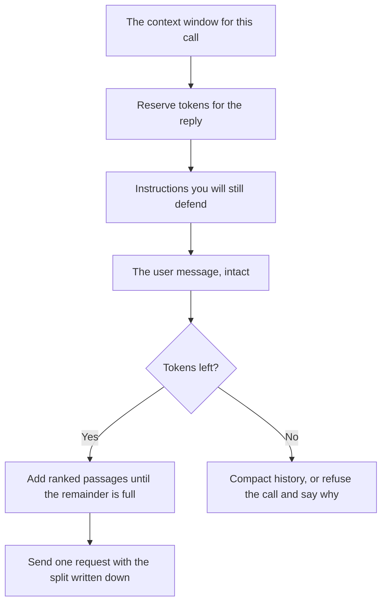

**Token budgeting is the split you make inside one request before you send it: how many tokens go to instructions, retrieved passages, prior turns, the user's message, and the reply you still need room to write.** The monthly allowance is a different decision. This page is the shape of a single call.

The unit is [what AI tokens are](/blog/what-are-ai-tokens-explained-2026/). The monthly split across teams is [what AI quota management is](/blog/what-is-ai-quota-management-2026/). A dollar ceiling is [what AI budget caps are](/blog/what-is-ai-budget-caps-2026/). Shrinking history so it fits the split you chose is [what prompt compaction is](/blog/what-is-prompt-compaction-2026/).

Prices are US list prices excluding tax from directory pages checked October 16, 2026. Published October 24, 2026. This page does not invent an API rate for ChatGPT, Claude, or Gemini. Where the directory records a per-token price, it is labeled. We did not measure how many tokens a prompt "should" use.

## The slices inside one call

| Slice | What belongs there | What goes wrong when it is uncapped |
|---|---|---|
| Instructions | The rules for this feature, short enough to reread | A policy novel that crowds out the user's question |
| Tools and schemas | The definitions the model needs for this turn | Every tool you own, including ones this feature never calls |
| Retrieved passages | The chunks that can support the answer, already ranked | A dump of the whole wiki |
| History | Turns that still change the answer | A month of chat, including resolved tangents |
| The user message | The question, intact | A truncated question and a confident answer to a different one |
| Reply reserve | Room for the completion you asked for | A cut-off answer because the prompt used the window |

Write the split in the client, next to the feature name. "Use as much context as possible" is how a short question inherits a long transcript. The reply reserve is part of the budget. A window that is full before generation starts will cut the answer or fail the call.

## What a seat price does not show

A chat subscription hides this split. You still feel it when a long thread forgets the constraint you set at the top, or when a file upload is summarized before you asked. The budget is the vendor's. You see the symptom.

**Claude Pro is $20 a month, or $17 billed annually.** Projects keep a file in reach. They do not print a token split on the invoice. The capacity choice above Pro is [Claude Pro vs Max](/blog/claude-pro-vs-max-2026/).

**ChatGPT Plus is $20 a month.** Go is $8 a month. Business is $20 a user a month billed annually, minimum two users. None of those rows, on the directory card, is a per-request token budget you edit. The ladder is [ChatGPT Go vs Plus vs Pro](/blog/chatgpt-go-vs-plus-vs-pro-2026/).

**Google AI Pro is $19.99 a month.** Plus is $4.99. Free exists. A long PDF in [Gemini Notebook](/tools/gemini-notebook/) is free with a Google account. The notebook still has a limit. The directory does not print that limit as a token integer on this card, so this page does not invent one.

**DeepSeek's API, on the directory card, starts at $0.15 per 1 million input tokens off-peak on a cache miss, and $0.60 per 1 million output tokens off-peak.** That is a meter you can budget because you own the client. A cache hit is a different price if the vendor's current card says so. This page does not copy a hit price the directory did not record. The tool page is [DeepSeek](/tools/deepseek/).

If you call an API, log the split: input tokens, output tokens, and which slice was truncated. That line belongs in [structured logging for AI](/blog/what-is-structured-logging-for-ai-2026/).

## A budget that survives a redesign

When you add a tool, add its schema size to the instructions slice and remove something else. When retrieval gets better, the passage slice can shrink because the top chunks are shorter, which is the point of [RAG](/blog/what-is-rag-explained-2026/). When a feature starts failing on long threads, compaction is the next page, after you have named the reserve.

A shared monthly quota can be healthy while one request is wasteful. Quota answers "who may spend." Token budgeting answers "what this call is allowed to carry."

## FAQ

### Is a bigger context window a budget?

A window is the maximum. A budget is the split you chose under that maximum. Paying for a larger window and filling it by default raises the bill and the chance the model attends to the wrong paragraph.

### Should the system prompt get half the window?

Only if you can read it and still explain every rule. Most features need a short instruction, an intact user message, a reply reserve, and a small set of passages. Copying a ratio from a blog, including this one, is how a simple question ships with a manual attached.

### Do chat products need this?

You need it when your software builds the prompt. A person chatting on a website can start a new thread. Software will keep appending until you reserve room for the answer.

### What if I do not know the token count?

Count with the tokenizer for the model you call, in your client, before you send. A word count is a rough hint. It is the wrong unit on the invoice.

## Last verified

October 16, 2026 for Claude, ChatGPT, Google AI plans, Gemini Notebook, and the DeepSeek API figures named above. Published October 24, 2026.

**Sources:** [Claude pricing](https://claude.com/pricing), [ChatGPT pricing](https://chatgpt.com/pricing/), [Google AI subscriptions](https://gemini.google/subscriptions/), [DeepSeek API docs](https://api-docs.deepseek.com/).

*Published by Andrew for [AI Tools Optimizer](https://aitoolsoptimizer.com).*

[Claude](/tools/claude/) is in the [chatbots and assistants directory](/tools/category/chatbots-assistants/). Directory pages may use affiliate links. A purchase through them may earn us a commission at no extra cost to you.
