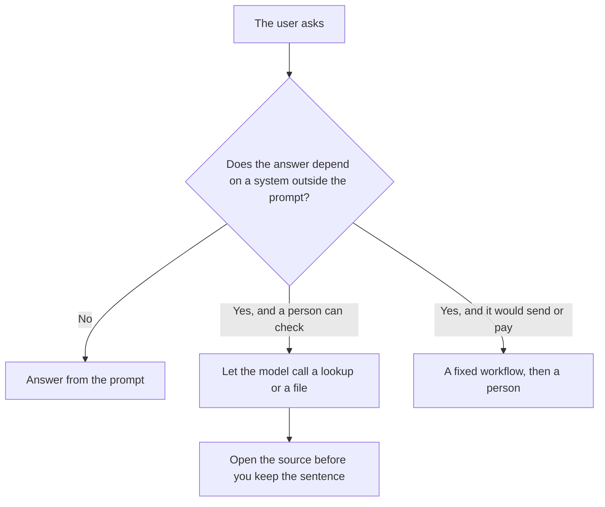

**Tool use is the model deciding it needs a system outside the prompt, then continuing from what that system returns.** The system might be web search, a code runner, a calculator, a file, or a calendar. The model proposes the call. Your app, or the vendor's app, runs it. The answer can be better because it saw today's page. It can also be worse because it trusted a bad result.

The wire format of that proposal is [what function calling is](/blog/what-is-function-calling-in-ai-2026/). Read that when you are building the call. Read this when you are deciding whether a product should be allowed to act. A shared plug shape for those tools is [what the Model Context Protocol is](/blog/what-is-model-context-protocol-2026/).

Prices are US list prices excluding tax from directory pages checked October 16, 2026, plus plan details recorded October 24, 2026 where a linked article re-read the vendor page. We did not score tool-use accuracy.

## Four kinds of tool, and the risk that matches

| Kind | Example | Reversible? | Buy it when |
|---|---|---|---|
| Lookup | Web search, a help-center passage, a paper | Yes. You can ignore the result | The fact changes, or it lives in a corpus |
| Compute | Code execution, a spreadsheet formula | Yes, if it does not write back | The model is bad at arithmetic and the rows are yours |
| Draft from a file | Reading an upload and outlining it | Yes | You already have the source and you will check the outline |
| Action | Send, pay, delete, post, merge | No | A person still approves, until the log shows the call is boring |

Lookup without a link is not tool use you can audit. [Perplexity](/tools/perplexity/) is the directory's clean case of search that ships with citations. Pro is $17 a month billed annually. Open the citation. The plan card is [Perplexity pricing explained](/blog/perplexity-pricing-explained-2026/).

## Products where tool use is already the default

| Product | The tool you are actually getting | Price to know |
|---|---|---|
| [ChatGPT](/tools/chatgpt/) | Search, files, image tools, and Codex on the plan that includes them. Advanced reasoning and expanded Codex start at Plus | Plus is $20/month. Free can do quick Codex tasks on the recorded matrix. Go at $8 is lightweight tasks and may include ads |
| [Claude](/tools/claude/) | Files, code execution, web search, and connectors on the free card. Claude Code starts at Pro | Pro is $20/month, or $17 billed annually. There is no free Claude Code |
| [Perplexity](/tools/perplexity/) | Retrieval over the web, with links | Pro is $17/month billed annually |
| [Lindy](/tools/lindy/) | An agent that can pick among email, calendar, and the integrations you connect | Team starts at $49.99/month for 5,000 credits. The trial is $50 in credits for 7 days |
| [Zapier](/tools/zapier/) | Not model-chosen. You drew the steps | Professional is $19.99/month billed annually for 750 tasks |
| [Cursor](/tools/cursor/) | Editor tools: Tab, Chat, and Agent, on a usage pool | Plus is $8/month on The X Subscription |

The coding version of this choice, where the tool is the repository, is [ChatGPT vs Claude for coding](/blog/chatgpt-vs-claude-for-coding-2026/). The editor versus the two agents is [Cursor vs Claude Code vs Codex](/blog/cursor-vs-claude-code-vs-codex-2026/). Lindy's invoice is [Lindy pricing explained](/blog/lindy-pricing-explained-2026/).

A path you drew is still the right tool when the branch is known. "When a form is submitted, create a row and ping a channel" should not ask a model whether to ping. That comparison is [Zapier vs Make vs n8n](/blog/zapier-vs-make-vs-n8n/). Make Core is from $9 a month billed annually. n8n's cloud prices were shown in euros. This page does not convert them.

## When to turn tool use off

**The source is already in the prompt.** Search will wander. Paste the paragraph and ask for the edit. A writing pass is [ChatGPT vs Claude for writing](/blog/chatgpt-vs-claude-for-writing-2026/).

**The action moves money or mail.** Tool use can draft the message. A person sends it. An agent platform is not a substitute for that click. The log of what ran is [what AI observability is](/blog/what-is-ai-observability-2026/).

**The corpus is your own files and the web would dilute it.** Use a notebook. [Gemini Notebook](/tools/gemini-notebook/) stays on what you upload. That pattern, extended to images and tables, is [what multimodal RAG is](/blog/what-is-multimodal-rag-2026/).

**You wanted a format, not a fact.** A template is a prompt. Tool use is for when the answer depends on a system. The craft of the prompt is [what prompt engineering is](/blog/what-is-prompt-engineering-2026/).

Each tool call spends [tokens](/blog/what-are-ai-tokens-explained-2026/) or a credit. A loop of calls is why an agent task costs more than a one-line rewrite. If the receipt surprises you, the surprise is the feature working, not a bug in the invoice.

## FAQ

### Is browsing the same as tool use?

Browsing is one tool. Code execution is another. A product can have one without the other. Read the plan card for the tool you need, not for the word "agent."

### Does the model have to use a tool every time?

No. A good product answers from the prompt when the prompt is enough. Forcing search on a style edit adds a citation you did not need and a chance to import someone else's sentence.

### Can tool use hallucinate?

Yes. It can misread the tool output, or the tool can return the wrong row. The habit is to open the row. A fluent summary of a bad search is still [a hallucination](/blog/what-is-ai-hallucination-2026/).

### Is Claude Code "tool use"?

Yes. It is tool use aimed at a repository, and it is included with Claude Pro, not with Free. ChatGPT's version is Codex, with meaningful access on Plus. Neither one merges code by itself unless you gave it that permission.

## Last verified

October 16, 2026 for Claude, Perplexity, Lindy, Zapier, Make, and Cursor prices. October 24, 2026 for the ChatGPT Codex rows as recorded in the Cursor, Claude Code, and Codex comparison. Published October 24, 2026.

**Sources:** [Claude pricing](https://claude.com/pricing), [ChatGPT pricing](https://chatgpt.com/pricing/), [Perplexity pricing](https://www.perplexity.ai/pro).

*Published by Andrew for [AI Tools Optimizer](https://aitoolsoptimizer.com).*

[Perplexity](/tools/perplexity/) is in the [research directory](/tools/category/research-search/). Directory pages may use affiliate links. A purchase through them may earn us a commission at no extra cost to you.
