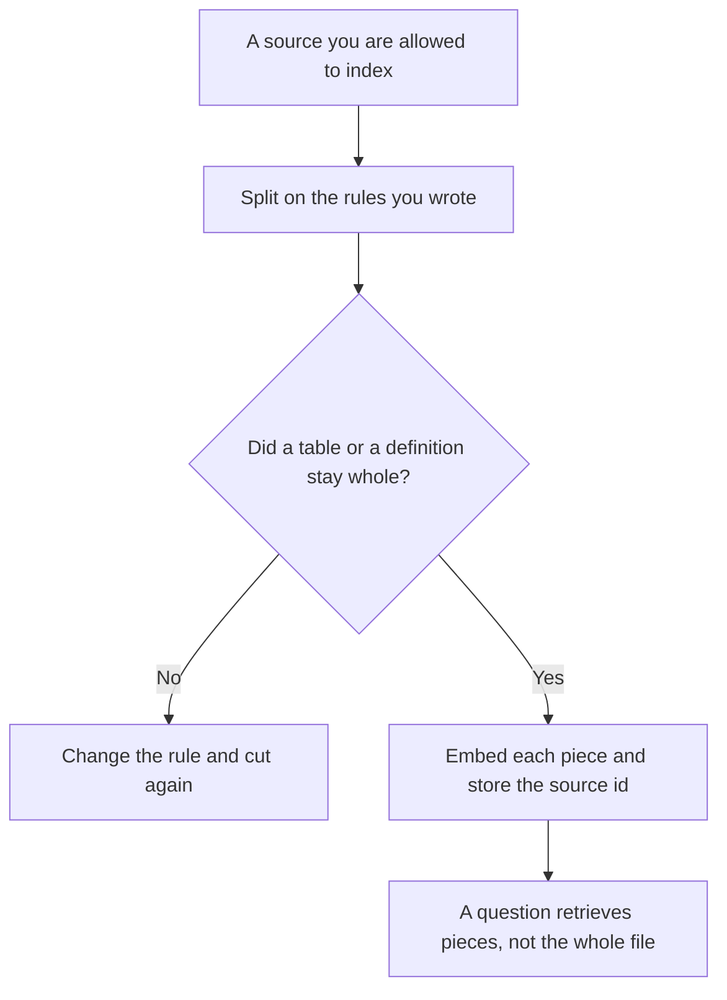

**Vector chunking is the way you split a source document into pieces before an embedding model turns each piece into numbers you can search.** The numbers are [what embeddings in AI are](/blog/what-is-embeddings-in-ai-2026/). The model that emits them is [what an embedding model is](/blog/what-is-an-embedding-model-2026/). The store you search is [what a vector database is](/blog/what-is-a-vector-database-2026/). The answer that should name a retrieved piece is [what RAG is](/blog/what-is-rag-explained-2026/). Chunking is the cut. A bad cut retrieves a heading with no paragraph, or a table split down the middle.

Putting the retrieved pieces into the window in an order is [what context packing is](/blog/what-is-context-packing-2026/). Searching with two methods and merging the lists is [what retrieval hybrid search is](/blog/what-is-retrieval-hybrid-search-2026/). Whether you fetched the right pages at all is [what retrieval evaluation is](/blog/what-is-retrieval-evaluation-2026/).

Prices are US list prices excluding tax from directory pages checked October 16, 2026. A live fetch of vendor pricing pages returned HTTP 401 on October 24, 2026, so this page stays on the directory record. Published October 24, 2026. The directory does not list a chunking fee, so this page does not invent one. We did not score retrieval quality.

## What you decide before the first cut

| Decision | Write it down | A cut that will hurt later |
|---|---|---|
| Unit | A section under a heading, a row, or a fixed size you measured | One giant file as one vector |
| Overlap | A small repeat so a sentence on the boundary survives | No overlap, and the answer sat on the cut |
| What stays whole | Tables, code blocks, definitions with their terms | A table split so no row is complete |
| Metadata | Title, source URL, date, and access label on every piece | A chunk with no way back to the page |
| What you exclude | Boilerplate, nav, and text the policy says not to index | The footer repeated on every hit |
| Rebuild rule | When the source changes, which pieces are replaced | Old and new chunks for the same paragraph |

Overlap is a copy of the boundary, not a second document. If you overlap so much that every chunk contains the whole section, you have paid to embed the section many times and you will retrieve duplicates. The date on the piece is [what retrieval freshness is](/blog/what-is-retrieval-freshness-2026/). A chunk with no date will outlive the page it came from.

## Where the rule is drafted

**The cutting note.** [Claude](/tools/claude/) Pro is $20 a month, or $17 billed annually, when the chunking rule is a long note: unit, overlap, what stays whole, and a sample of three chunks a person will read. The review is [Claude review](/blog/claude-review-2026/).

**The source, when it already lives in the workspace.** [Notion AI](/tools/notion-ai/) Business is $20 a seat a month if the pages you would chunk are the wiki. Chunk the page you are willing to cite. A chat answer is not an index. The wiki decision is [Notion AI vs ChatGPT for wikis](/blog/notion-ai-vs-chatgpt-for-wikis-2026/).

**A cited scan, which is not your index.** [Perplexity](/tools/perplexity/) Pro is $17 a month billed annually when you need sources on the public web. That is a search product. It does not apply your chunking rule to your private corpus. The invoice is [Perplexity pricing explained](/blog/perplexity-pricing-explained-2026/).

**Files you already hold in Google.** [Gemini](/tools/gemini/) is free with a Google account. Google AI Pro is $19.99 a month when the packet lives in Drive and you want Gemini in Docs. Uploading a packet is not the same as choosing a chunk size for your own index. The ladder is [Gemini pricing explained](/blog/gemini-pricing-explained-2026/).

A prompt that holds the line:

"Propose cuts for this sample using only the unit, the overlap, and the keep-whole rules I pasted. Show the source id on each piece. Do not summarize the pieces into a new document. If a table would split, write Keep whole and stop."

## What not to delegate

Do not let a model pick a chunk size because a blog post said 500 tokens. Do not index a document your retention rule says to delete. Do not drop the heading. A chunk that starts mid-sentence can still match a query and then mislead the answer. Read three chunks from a real document before you embed the corpus. If a person cannot tell what the piece is about, the retrieval layer will not do better.

## FAQ

### Is chunking the same as summarization?

No. A summary is a new text. A chunk is a piece of the source, stored so you can return to that source. You may store a summary as well, and you should label it as a summary. If the answer cites a summary, say so.

### How much overlap is enough?

The amount you measured on a sample, where a sentence that crossed a boundary still appeared in one piece a person could read. There is no universal token count on this page, because the directory does not record one and a borrowed number would be a guess.

### Do headings go in every chunk?

The heading, the source, and the date should travel with the piece. A bare paragraph that matched on one word will be retrieved without the section that explains it. Metadata is part of the chunk, even when it is not part of the prose.

### When do we re-chunk?

When the rule changes, or when the source changes. Re-embedding a changed paragraph and leaving the old chunk in the index gives you two answers. The rebuild rule names which id wins.

## Last verified

October 16, 2026 for Claude, Notion AI, Perplexity, and Gemini. Published October 24, 2026. Live pricing fetches returned HTTP 401 that day.

**Sources:** [Claude pricing](https://claude.com/pricing), [Notion pricing](https://www.notion.com/pricing), [Perplexity pricing](https://www.perplexity.ai/pro), [Gemini subscriptions](https://gemini.google/subscriptions/).

*Published by Andrew for [AI Tools Optimizer](https://aitoolsoptimizer.com).*

[Perplexity](/tools/perplexity/) is in the [research and search directory](/tools/category/research-search/). Directory pages may use affiliate links. A purchase through them may earn us a commission at no extra cost to you.
