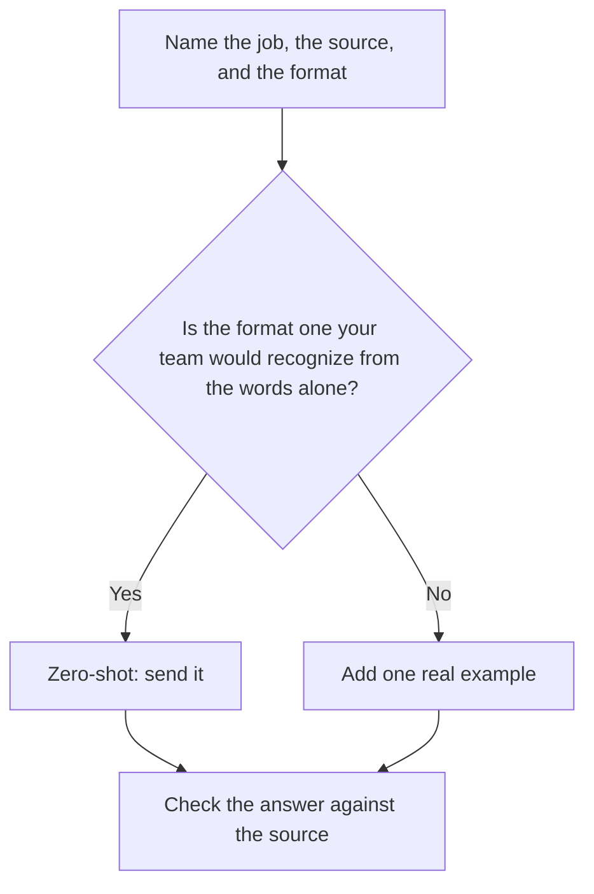

**Zero-shot prompting means you describe the task and attach the source, and you do not include a worked example.** The model has to infer the format from the instruction alone. That is the right default for a familiar job. It is a weak default when the format is easy to miss, such as a subject line, a rubric, or a row in a table you already use.

"Shot" here means an example inside the prompt. Zero examples is zero-shot. One or more examples is few-shot. Neither phrase adds knowledge. The source still has to be in the prompt or in a tool that can retrieve it. The wider skill is [what prompt engineering is](/blog/what-is-prompt-engineering-2026/).

Prices are US list prices excluding tax from directory pages checked October 16, 2026. Published October 24, 2026.

## Zero-shot beside the alternatives

| Pattern | What you include | Use it when |
|---|---|---|
| Zero-shot | The job, the source, the format, the boundary | The format is ordinary: a summary, a list, a short email |
| Few-shot | The same, plus one or two finished examples | The format is local to your team and easy to drift |
| Chain-of-thought | An instruction to show the steps before the answer | The task is multi-step and you will read the steps. See [what chain-of-thought prompting is](/blog/what-is-chain-of-thought-prompting-2026/) |
| A standing system prompt | Rules that apply before this message | The rule is stable across tasks. See [what a system prompt is](/blog/what-is-a-system-prompt-2026/) |

A longer slogan is still zero-shot. "You are a world-class strategist" contains no example and no source. The draft that follows has to be edited like any other draft. The editing standard is [how to write a blog post with Claude](/blog/how-to-write-a-blog-post-with-claude-2026/).

## A zero-shot prompt that carries its weight

Include four lines:

1. The job and the reader. "Draft a reply to this customer for a support lead."
2. The source. Paste the ticket and the help paragraph that applies.
3. The format. "Under 120 words. End with the one next step."
4. The boundary. "If the help paragraph does not mention a refund, do not offer one."

That prompt has zero examples. It is still specific. Teams skip the boundary and then blame the pattern. The model filled a gap because the instruction allowed a gap.

| Job | Zero-shot is enough | Add an example |
|---|---|---|
| Summarize a call into decisions, owners, and dates | Yes, if you name those three columns | When your notes use an internal status word |
| Rewrite a sentence you already wrote | Often the sentence is the example | [Grammarly](/tools/grammarly/) is the product that does this in the browser. Pro is $12/member/month billed annually, or $30 monthly |
| Classify tickets into your five labels | Risky. The labels need definitions | Paste one ticket per label |
| A legal or medical claim | The pattern is beside the point | Use the source document, and a person signs it |

Grammarly is a zero-shot editor in practice: you hand it a sentence, and you do not paste a corpus. The $12 annual seat is the rewrite and tone layer. Whether to buy it is [is Grammarly Pro worth it](/blog/is-grammarly-pro-worth-it-2026/).

## Where you will type it

[Claude](/tools/claude/) Pro is $20 a month, or $17 billed annually. [ChatGPT](/tools/chatgpt/) Plus is $20. [Gemini](/tools/gemini/) is free with a Google account, and Google AI Plus is $4.99 a month. All three accept a zero-shot instruction on the free tier. Pay when a cap blocks a workday, or when the draft has to land inside Docs, Gmail, or Drive, which is Gemini's case.

Few-shot costs more tokens because the examples travel with every request. The meter is [what AI tokens are](/blog/what-are-ai-tokens-explained-2026/). For a one-page email, an example is cheap. For a prompt you will call ten thousand times through an API, an example is a line item. Measure it. The dial that changes how much the wording varies is [what temperature is](/blog/what-is-temperature-in-ai-models-2026/).

## FAQ

### Is zero-shot worse than few-shot?

It is worse when the format is idiosyncratic. It is better when an example would bias the model toward one sample's wording. Start with zero-shot. Add one real example when the first answer misses the shape, and keep the source attached either way.

### Does zero-shot mean the model has no training?

No. The model was trained before you arrived. Zero-shot means this prompt contains no new example. The training-versus-answer split is [what inference vs training is](/blog/what-is-ai-inference-vs-training-2026/).

### Should I add "think step by step" to every zero-shot prompt?

Add it when you will read the steps and the task has more than one hop. For a format you already specified, the extra reasoning text is cost and length. Chain-of-thought is a separate choice, covered in [what chain-of-thought prompting is](/blog/what-is-chain-of-thought-prompting-2026/).

### Can zero-shot prompting invent facts?

Yes. A clear format does not create a source. Paste the source, and require an abstention when it is silent. That failure is [what an AI hallucination is](/blog/what-is-ai-hallucination-2026/).

## Last verified

October 16, 2026 for plan prices. Published October 24, 2026.

**Sources:** [Claude pricing](https://claude.com/pricing), [OpenAI ChatGPT pricing](https://openai.com/chatgpt/pricing/), [Grammarly pricing](https://www.grammarly.com/plans).

*Published by Andrew for [AI Tools Optimizer](https://aitoolsoptimizer.com).*

[Claude](/tools/claude/), [ChatGPT](/tools/chatgpt/), and [Gemini](/tools/gemini/) are in the [chatbots directory](/tools/category/chatbots-assistants/). Directory pages may use affiliate links. A purchase through them may earn us a commission at no extra cost to you.
