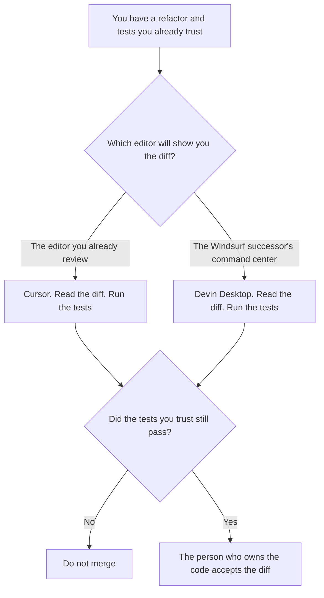

**Use Cursor when the refactor should happen in the editor you already have open, and you will read the diff in that tree before you merge. Use Devin Desktop, the editor the Windsurf name now points at, when you want that successor's agent command center and you will still read the same kind of diff.** A refactor is a behavior-preserving change across files, proved by tests you already trust. A cleaner file is not a refactor.

The terminal-agent cut is [Claude vs Cursor for refactors](/blog/claude-vs-cursor-for-refactors-2026/). The GitHub-seat cut is [Cursor vs GitHub Copilot for refactors](/blog/cursor-vs-github-copilot-for-refactors-2026/). Cursor's bill is [Cursor pricing explained](/blog/cursor-pricing-explained-2026/).

Devin Desktop's prices below are the October 16, 2026 directory card, which matches the page at windsurf.com/pricing fetched October 24, 2026. That page is titled Devin Plans and Pricing. Cursor's Plus price is the October 24 help-center figure. Published October 24, 2026. We did not score refactors. The directory lists this editor as Devin Desktop, formerly Windsurf. It does not list a separate Windsurf seat.

## Which editor the change lives in

| The change | Start here | First paid step | The limit |
|---|---|---|---|
| A diff in the editor you already review | [Cursor](/tools/cursor/) | Plus is $8 a month, or $80 a year | Plus omits Cloud Agents, Automations, Bugbot, Origin, and third-party models, on the October 24 help page |
| The Windsurf successor, with an agent command center | [Devin Desktop](/tools/devin-desktop/) | Pro is $20 a month on the October 16 card and the October 24 pricing page | Enterprise is "Let's talk" on that page. This page does not invent a dollar |
| A terminal agent on the Claude seat | [Claude Code](/tools/claude-code/) | Included on Claude Pro, at $17 a month billed annually or $20 monthly | Read the other refactor page before you buy a second editor for this |
| A GitHub seat with a published company dollar | [GitHub Copilot](/tools/github-copilot/) | Pro is $10 a month on the October 16 card | The refactor cut against Cursor is the Copilot article, not this one |

The directory card says Windsurf became Devin Desktop on June 2, 2026, and the October 24 fetch of windsurf.com/pricing shows Devin's plans: Free at $0, Pro at $20 a month, Max at $200 a month, and Teams at $80 a month for the team plan plus $40 a month per full developer seat, up to 200 users. Enterprise on that page says "Let's talk" and lists SAML/OIDC SSO, centralized admin controls, and a dedicated deployment option, including deploy in your VPC. It does not list a seat price. A Teams invoice is not an Enterprise invoice.

Cursor Plus is $8 a month, or $80 a year, for one person. The help page says Plus omits Cloud Agents, Automations, Bugbot, Origin, and third-party models. Teams is $30, $100, or $200 a seat a month. Enterprise is contact sales, with pooled usage, SCIM, audit logs, and invoice billing, and no dollar on that page. The company seat with a list price is [Cursor Business pricing explained](/blog/cursor-business-pricing-explained-2026/). The sales row is [Cursor Enterprise pricing explained](/blog/cursor-enterprise-pricing-explained-2026/).

Neither sticker proves a refactor. The tests you already trust do. If those tests do not exist, the job is not a refactor yet. Write them, or do not call the diff behavior-preserving.

## What the diff is allowed to change

Names, structure, and calls, in ways the tests already cover. A behavior change is a feature. A deleted test so the suite goes green is a different failure, covered on [Cursor vs Claude Code for tests](/blog/cursor-vs-claude-code-for-tests-2026/). If the owner of the behavior is missing, the line says Owner not set.

**Cursor Plus** is the editor diff at $8. Premium is $30 a month if you need the next individual tier. The review is [Cursor review](/blog/cursor-review-2026/).

**Devin Desktop Pro** is $20 a month for the successor editor. Max is $200. The directory's product page is the card above. This site does not have a separate Windsurf review to send you to.

**Claude Code** comes with Claude Pro. Use it when the work is a terminal agent, and link the Claude-versus-Cursor refactor page. This page does not restate that choice as if it were Windsurf.

A prompt that holds the line:

"Propose the refactor from the behavior I pasted and the tests I named. Do not change the behavior. Do not delete a test. If a test is missing, write Test not named."

## What not to delegate

Do not ask which editor "refactors better." Do not merge because the command center showed a card as done. Do not quote an Enterprise dollar for Devin or for Cursor. The person who owns the code accepts the diff.

## FAQ

### Is Windsurf still a separate product on this site?

The directory lists Devin Desktop, formerly Windsurf, last verified October 16, 2026. The page at windsurf.com/pricing on October 24, 2026 is titled Devin Plans and Pricing and shows the dollars above. This page links that directory entry. It does not invent a second Windsurf price.

### How is this different from Claude vs Cursor for refactors?

That page is a terminal agent on the Claude seat against Cursor's editor. This page is the Windsurf successor's editor against Cursor's editor. You can use Claude Code from either place. You still read the diff.

### How is this different from Cursor vs GitHub Copilot?

That page is Cursor against the GitHub seat. Copilot Pro is $10 on the October 16 card, and Enterprise is $39 on [GitHub Copilot Enterprise pricing explained](/blog/github-copilot-enterprise-pricing-explained-2026/). This page does not re-rank those two. It prices the editor the Windsurf URL now opens.

### Who may merge?

The person who owns the code, after the tests they trust have passed. Test not named means it is not a refactor yet. A green agent card is not a review.

## Last verified

October 24, 2026 for windsurf.com/pricing, which presented Devin's plans, and for Cursor's help page. October 16, 2026 for the Devin Desktop directory card and for GitHub Copilot. October 24, 2026 for Claude Code's inclusion on Claude Pro, via the Claude pricing article. Published October 24, 2026. Devin Enterprise and Cursor Enterprise have no dollar on those pages.

**Sources:** [Devin plans](https://windsurf.com/pricing), [Cursor pricing](https://cursor.com/help/account-and-billing/pricing), [Claude pricing](https://claude.com/pricing), [GitHub Copilot plans](https://github.com/features/copilot/plans).

*Published by Andrew for [AI Tools Optimizer](https://aitoolsoptimizer.com).*

[Cursor](/tools/cursor/) is in the [coding directory](/tools/category/coding/). Directory pages may use affiliate links. A purchase through them may earn us a commission at no extra cost to you.
