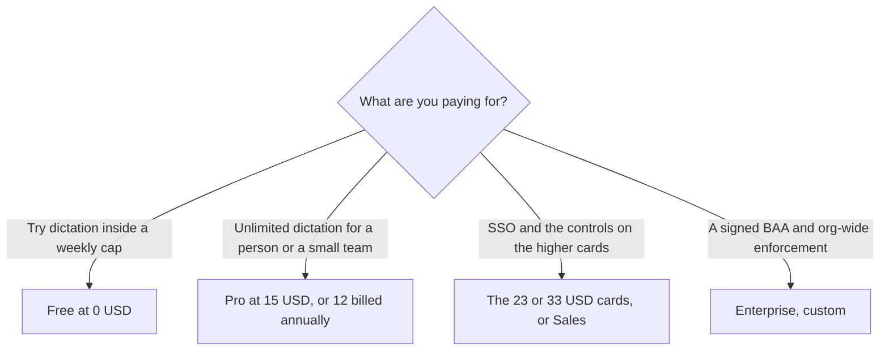

**Wispr Flow Pro is $15 per user per month on the monthly card, or $12 per user per month when the annual discount is on.** Free is $0. The same October 24, 2026 capture of wisprflow.ai/pricing also showed $23 and $33 per user per month, with annual figures of $18 and $26. The page labeled a 20% annual discount. Enterprise is a sales conversation. This page prices dictation and the notetaker limits the page actually printed.

The product page is [Wispr Flow review](/blog/wispr-flow-review-2026/). A tool that reads text aloud, which is the other direction, is [Speechify pricing explained](/blog/speechify-pricing-explained-2026/). A meeting note without a bot, on a different product, is [Granola pricing explained](/blog/granola-pricing-explained-2026/).

Published October 24, 2026. Prices are US list prices as shown on that page. The directory page checked October 16, 2026 had recorded the same Pro pair and had named the $23 and $33 cards Growth and Growth with Notetaker. The October 24 marketing copy we captured emphasized Free, Pro, and Enterprise, and still showed those higher figures. We did not score accuracy.

## The figures on the October 24 page

| What the page showed | Monthly | Annual, per user per month | What the surrounding text said |
|---|---|---|---|
| Free | $0 | $0 | Dictation on Mac, Windows, iOS, and Android. 2,000 a week on desktop. Limited weekly use on mobile. Limited Notetaker |
| Pro | $15 | $12 | Unlimited dictations, longer Notetaker history, centralized billing. The page called it the most popular plan |
| A higher pair | $23 | $18 | Shown beside SSO with SAML in the same capture |
| A second higher pair | $33 | $26 | Shown in the same cluster as the $23 line |
| Enterprise | Custom | Custom | The FAQ points teams at Sales for SSO, advanced dashboards, and compliance controls |

Fifteen dollars times 0.8 is $12. The page's 20% annual line matches the Pro pair. The October 16 directory recorded annual Pro as $144 a year, which is $12 times 12. The October 24 page showed the $12 monthly-equivalent more clearly than the $144 total. Quote $15 if you pay month to month.

The October 16 directory recorded free desktop use as 2,000 words a week on Mac and Windows, with a 5,000-word maximum stated in the tool's FAQ, and 1,000 words on mobile. The October 24 page text we captured said 2,000 a week on desktop and limited weekly use on mobile. It did not repeat the mobile word count in that capture. Use the in-app counter for the cap you will hit.

## Notetaker, students, and the October 31 line

The October 24 FAQ says the free plan includes Notetaker with speaker identification, a weekly meeting limit, and no bot in the call. Notetaker runs on Mac and Windows. Recordings under five minutes do not count toward the meeting limit. Pro includes Notetaker at no extra cost, with a note that the rollout to existing Pro users is gradual, plus higher meeting limits and longer note retention than Free.

A banner in the same capture said full Notetaker access was available through October 31 at no additional cost on a dictation selection. That date is a promotion window. Do not quote it as the lasting price of the notetaker after October 31, 2026.

Students: the October 24 FAQ says students and educators with an education email get 50% off Pro, and that nonprofits get a discounted rate. It does not print the discounted dollar. The October 16 directory recorded a $0 Student plan for eligible .edu addresses, and a paid student price of $7.50 a month or $72 a year where that free route does not apply. The October 24 FAQ we read did not restate a $0 plan. Checkout is the student price.

The page also says HIPAA-ready dictation can come with a signed BAA, and that Notetaker and Scratchpad are disabled on BAA accounts. If you need the notetaker and a BAA, read that constraint before you buy. This page does not give legal advice.

**Speechify** is the wrong tool if you need text read to you. **Granola** Business at $14 a user a month is the wrong tool if you need dictation into every app, and the right comparison if the job is meeting notes. **Otter** is a meeting bot with a minute cap. Flow's notetaker, on the October 24 page, does not join as a bot.

## What not to assume

Do not quote Pro at $12 if you are paying monthly. Do not treat the October 31 notetaker line as permanent. Do not promise a teammate the $0 student plan from the October 16 directory if checkout now shows 50% off. Do not assume Enterprise has a public dollar. It does not, on the page we read.

## FAQ

### How much is Wispr Flow Pro?

On October 24, 2026, the pricing page showed Pro at $15 per user per month, or $12 per user per month on the annual discount. Annual Pro at $144 a year is the October 16 directory total for that $12 figure.

### Is Wispr Flow free?

Yes. The page says you can start without a credit card. Free includes dictation and a limited Notetaker. Desktop use in the capture was 2,000 a week, with limited weekly use on mobile.

### What are the $23 and $33 prices?

They were on the October 24 capture, with annual equivalents of $18 and $26. The October 16 directory named those pairs Growth and Growth with Notetaker. The October 24 headings we captured pushed Pro for teams and Sales for SSO. If checkout still shows Growth, checkout wins.

### Is it free for students?

The October 24 FAQ says an education email gets 50% off Pro. It does not print a $0 plan. The October 16 directory recorded a $0 Student plan for eligible .edu users. Read checkout before you tell a student the tool is free.

## Last verified

October 24, 2026, from wisprflow.ai/pricing. The Growth names and the $144 annual total are from the directory page checked October 16, 2026. Published October 24, 2026.

**Sources:** [Wispr Flow pricing](https://wisprflow.ai/pricing), [Flow plans](https://docs.wisprflow.ai/articles/9559327591-flow-plans-and-what-s-included).

*Published by Andrew for [AI Tools Optimizer](https://aitoolsoptimizer.com).*

[Wispr Flow](/tools/wispr-flow/) is in the [audio, voice, and music directory](/tools/category/audio-voice-music/). Directory pages may use affiliate links. A purchase through them may earn us a commission at no extra cost to you.
