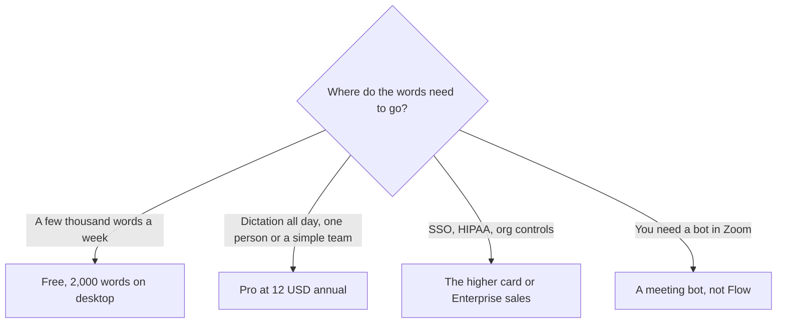

**[Wispr Flow](/tools/wispr-flow/) is dictation that types into the app you already use, on Mac, Windows, iPhone, and Android.** It also has a notetaker that runs on the device, without a bot joining the call. On October 24, 2026 the pricing page showed Free at **$0**, Pro at **$15 per user per month** on the monthly control and **$12 per user per month** on the annual control, and a second paid card at **$23 monthly** and **$18 annual**, with **$33** and **$26** also printed beside those higher controls. The annual toggle is labeled **20% off**. Students and educators get **50% off Pro** with an education email. Enterprise security is a sales conversation.

We did not measure words per minute or accuracy. The review is the cap on the free plan and the seat price if dictation becomes how you write. A notetaker that does not join as a bot is a different product from [Otter](/tools/otter-ai/) or [Fireflies](/tools/fireflies-ai/), and it should be priced that way.

## What the cards printed

| What we could see | Monthly | Annual, 20% label | Who it is for, in Wispr's words |
|---|---|---|---|
| Free | $0 | $0 | Everyone. Dictation in any app, 100+ languages, dictionary and snippets, limited notetaker |
| Pro | $15/user | $12/user | Individuals and teams. Unlimited dictation, longer notetaker history, centralized billing |
| Second paid card | $23, with $33 also shown | $18, with $26 also shown | The block labeled most popular on the monthly view: unlimited notetaker, SSO, org-wide HIPAA with a BAA |

The comparison table's free column includes **2,000 words a week on desktop** and limited weekly use on mobile. That 2,000-word line is the practical free cap for people who write on a computer. Mobile is tighter. Pro is the plan that removes the dictation limit. The FAQ says free includes the notetaker with a weekly meeting limit, and that recordings under five minutes do not count toward it. Pro keeps more meetings for longer. Notetaker is Mac and Windows for now. The pricing page, on the day we read it, also said full notetaker access was available through **October 31**. That date is a week after this review. If you are reading later, check whether the promo ended and whether the $23 or $33 figure was the promo price or the standing price.

## Dictation first, notes second

Flow's main job is replacing the keyboard in whatever app is focused: mail, docs, an IDE, a ticket. The dictionary learns names. Snippets expand phrases. Pro adds unlimited dictation, team billing, and a shared dictionary. The FAQ says you can invite teammates with no minimum seat and no upfront payment, then manage them from Pro. That is a small-team shape. The higher card is where SSO, SAML, a BAA, and admin control over model training show up in the feature grid. The FAQ also says to contact sales for Enterprise when you want those compliance controls. Both statements were on the page. If you need a signed BAA, do not assume the self-serve $23 card is the contract. Ask sales for the agreement, and use the self-serve card only for the product trial.

The notetaker listens on the device. Other people in the meeting do not get a bot asking to join. That is the privacy story, and it is also the limitation: it does not cover a call you did not attend, and it does not run on mobile yet. [Granola](/tools/granola/) and Otter are the meeting products people compare it with. If the job is a transcript of a call you were not in, Flow is the wrong tool. If the job is notes from a conversation happening in the room, plus dictation afterward, Flow is the tool whose price starts at $0 and steps to $12.

[Speechify](/tools/speechify/) is the listening app, Premium at $29 on the monthly card. Flow is the speaking app. They solve opposite directions of the same accessibility problem. Buying both is coherent. Buying Flow to read a PDF aloud is not. [Best AI productivity tools](/blog/best-ai-productivity-tools-2026/) is the wider set of seats this can replace, especially if dictation deletes a writing assistant you were only using because typing was slow.

## A year of Pro, as arithmetic

Pro at $12 is **$144 a year** per person. At $15 monthly it is **$180** if you stay. The 20% label matches $12 being 20% under $15. The higher card at $18 annual is **$216 a year**, and at $23 monthly it is **$276**. The extra dollars are the admin and compliance lines, not faster dictation. A five-person team on Pro annual is **$720**. The same team on the $18 card is **$1,080**. Student Pro at 50% off the Pro price is the education path. Confirm it applies to the annual $12 and not only to a monthly experiment.

Data controls exist on the free plan too: Wispr says you can opt out of model training, choose what stays on device, and delete it. Enterprise makes those choices org-wide. A solo writer does not need Enterprise to opt out. A clinic or a law firm might need the BAA before anyone dictates a client name. That is a legal decision, and the pricing page is not the BAA.

## Who should pay

**Use free** while 2,000 desktop words a week cover your writing and the meeting limit covers the calls you care about. **Pay for Pro** when the cap interrupts real work, at $12 if you will keep it a year. **Move to the higher card or to sales** when SSO or a BAA is the requirement, and get the agreement in writing if the FAQ and the card seem to disagree about what is self-serve. **Skip Flow** if you wanted a meeting bot, a voice clone, or a screen reader. Those are [Otter](/blog/otter-ai-review-2026/), a voice studio, and Speechify.

## FAQ

### How much does Wispr Flow cost?

Free is $0. Pro is $15 per user per month, or $12 on the annual toggle labeled 20% off. A second paid card shows $23 and $18, with $33 and $26 also printed. Checked October 24, 2026.

### What is included free?

Dictation in any app, 100+ languages, a dictionary, snippets, and a limited notetaker. The comparison table lists 2,000 words a week on desktop. Mobile is a lower weekly allowance. No card is required.

### Does the notetaker join my meeting?

Wispr says no. It runs on your device, on Mac and Windows, for meetings and in-person conversations. It does not attend a call for you.

### Is there a student discount?

Yes. Students and educators with an education email get 50% off Pro. Nonprofits can ask for a discounted rate. Free remains available without that discount.

### What is the October 31 date?

The pricing page said full notetaker access was included through October 31 when we read it. Confirm the date if you are buying for the notetaker rather than for dictation. Promos end.

## Last verified

October 24, 2026, from Wispr Flow's pricing page. The second card's paired prices ($23/$33 and $18/$26) look like a toggle between dictation and notetaker packaging. Select the options you will actually use and read the total. Do not average them.

**Sources:** [Wispr Flow pricing](https://wisprflow.ai/pricing), [Flow plans](https://docs.wisprflow.ai/articles/9559327591-flow-plans-and-what-s-included), [Wispr Flow](https://wisprflow.ai).

[Wispr Flow](/tools/wispr-flow/) is in the [audio directory](/tools/category/audio-voice-music/). Directory pages may use affiliate links. A purchase through them may earn us a commission at no extra cost to you.
