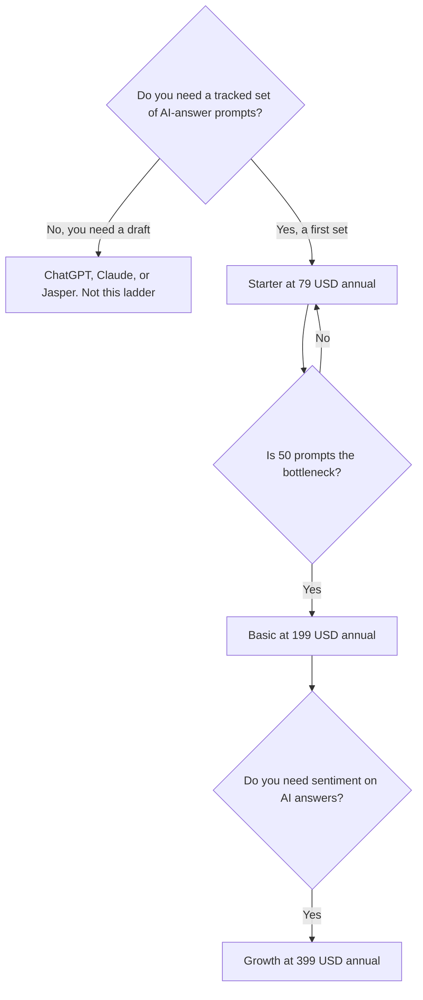

**Writesonic's published entry price is Starter at $79 a month billed annually, and the thing you are buying is AI-answer tracking plus a capped article allowance, not a general writing chatbot.** Basic is $199 a month on that annual billing. Growth is $399. Enterprise is custom. The annual view read October 24, 2026 prints a yearly savings on each card: $240, $600, and $1,200. If you wanted a draft and a chat, this ladder starts too high.

The product page is [Writesonic review](/blog/writesonic-review-2026/). The three-way is [Jasper vs Copy.ai vs Writesonic](/blog/jasper-vs-copy-ai-vs-writesonic-2026/). The marketing seat next door is [Jasper vs ChatGPT for marketing](/blog/jasper-vs-chatgpt-for-marketing-2026/).

Prices below follow that October 24 pricing-page read, which is later than the October 16 directory table. Where the two records disagree on articles, seats, or the Action Center, this explainer follows October 24 and says so. Published October 24, 2026. We did not score visibility or articles.

## The ladder

| Plan | Annual rate | Savings printed on the card | What the October 24 read could confirm |
|---|---|---|---|---|
| Starter | $79/month | $240 a year | 50 prompts, daily answer tracking, 15 AI articles, 10 site audits of 100 pages, 1 user, 1 project |
| Basic | $199/month | $600 a year | 100 prompts and a higher daily answer count. The card describes SEO and AI-search tracking together |
| Growth | $399/month | $1,200 a year | The card marked sentiment analysis available here |
| Enterprise | Custom | — | Action Center is marked available on Enterprise |

There is a free trial. The October 24 read did not find a permanent free plan. The page's monthly/annual control is marked save 20%. The savings figures are what the cards print. A monthly price implied by the savings is arithmetic, not a second number rendered on the annual view: Starter $79 + $240/12 = $99, Basic $199 + $600/12 = $249, Growth $399 + $1,200/12 = $499. Flip the toggle before you quote a monthly invoice. A year of Starter at the printed annual rate is $79 × 12 = $948. Basic is $2,388. Growth is $4,788. Those are the annual rates, not the implied monthly path.

Extra users are listed at $50 per user per month on that read. Starter includes one user. A second login is $50, or $600 a year, on top of the plan. An article add-on is printed around 20 more articles for $100 a month. The October 16 directory table listed different article counts, seat counts, and an Action Center trial on Growth. The later page marks the Action Center on Enterprise and sentiment on Growth. Use the card in front of you if it has moved again.

## What a prompt is, on this bill

The meter is prompts and answers tracked, not chat messages. Starter's 50 prompts is a monitoring quota. The article allowance on that same card is 15 a month, not 50. If the pitch you heard was "unlimited blog posts," you are on the wrong sentence of the card.

Growth is where sentiment shows up. The Action Center is the Enterprise line on the October 24 read. Buy Growth when sentiment or the larger prompt set is the reason. Do not buy it because $399 sounds like the serious plan, and do not expect the Action Center on it.

A writing seat is a different invoice. [ChatGPT](/tools/chatgpt/) Plus is $20. [Claude](/tools/claude/) Pro is $20, or $17 billed annually. [Jasper](/tools/jasper/) Pro is $59 a seat billed yearly, or $69 monthly, and the directory puts Jasper's own GEO features on Business, which is custom. [Copy.ai](/tools/copy-ai/) Chat is $24 billed annually for 5 seats, then workflow plans from $1,000. That card is [Copy.ai pricing explained](/blog/copy-ai-pricing-explained-2026/). Use Writesonic when the question is whether AI answers mention you. Use the writing seats when the question is the draft.

## Writesonic next to an SEO suite

[Semrush](/tools/semrush/) SEO is $139 a month, or $117.33 billed annually. Semrush One Starter, which bundles SEO and AI search, is $199 or $165.17 annually, on the review. That is a broad dataset. Writesonic Starter at $79 is a narrower AI-visibility product with articles and audits attached. They overlap in a slide deck and not in the invoice. The Semrush card is [Semrush review](/blog/semrush-review-2026/). The aisle is [best AI SEO tools](/blog/best-ai-seo-tools-2026/).

[Surfer SEO](/tools/surfer-seo/) starts at $82 a month billed yearly for AI Search Analytics, or $99 a month yearly for Standard, on the directory page. Surfer is an on-page optimization seat. It is not this prompt tracker. The switch list is [Surfer SEO alternatives](/blog/surfer-seo-alternatives-2026/). The brief, before any of these tools write, is [how to use AI for SEO briefs](/blog/how-to-use-ai-for-seo-briefs-2026/).

Track prompts a buyer would actually type. A list of brand-vanity questions will tell you that you are famous to yourself. The content calendar those gaps should feed is [how to build an AI content calendar](/blog/how-to-build-an-ai-content-calendar-2026/).

## FAQ

### How much is Writesonic Starter?

$79 a month billed annually, on the October 24 pricing page, with 50 prompts, 15 AI articles, and one user. The card prints a $240 a year saving versus monthly. A year at $79 a month is $948 before tax. A second user is $50 a month on that read.

### Is there a cheaper Writesonic plan for writers?

Not on this card. The product is priced as AI search visibility. For a writing seat, compare ChatGPT Plus at $20, Claude Pro at $20 or $17 annually, or Jasper Pro at $59 yearly. Those are not lite versions of Starter. They are a different job.

### Does annual billing save 20%?

That is the label on the control. The cards also print dollar savings: $240, $600, and $1,200 a year. The implied monthly rates from those savings are $99, $249, and $499. They are arithmetic. Read the monthly toggle before you send a quote.

### What happens after the trial?

You pick a paid plan or you stop. There is no permanent free plan on the read we are using. Do not build a reporting habit on a trial you have not priced.

## Last verified

October 24, 2026 for Writesonic's annual prices, savings, article cap, $50 extra user, and the Action Center sitting on Enterprise, as recorded in the Writesonic review from the pricing page. October 16, 2026 for Jasper, ChatGPT, Claude, Copy.ai, Semrush, and Surfer comparison prices. The older directory table is not the ladder above. Published October 24, 2026.

**Sources:** [Writesonic pricing](https://writesonic.com/pricing), [Semrush pricing](https://www.semrush.com/pricing/), [Jasper pricing](https://www.jasper.ai/pricing).

*Published by Andrew for [AI Tools Optimizer](https://aitoolsoptimizer.com).*

[Writesonic](/tools/writesonic/) is in the [writing directory](/tools/category/writing/). Directory pages may use affiliate links. A purchase through them may earn us a commission at no extra cost to you.
