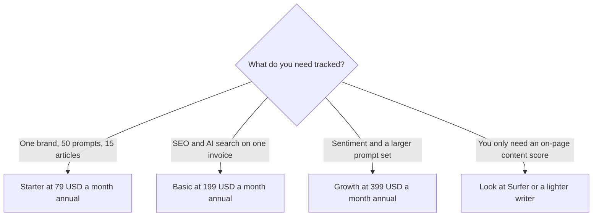

**[Writesonic](/tools/writesonic/) is a content and AI-search platform.** The current pricing page is not a $20 blog-writer menu. On October 24, 2026, with annual billing showing, Starter was **$79 a month**, Basic was **$199 a month**, and Growth was **$399 a month**. Each card prints a yearly savings figure: $240, $600, and $1,200. Extra users are listed at **$50 per user per month**. There is a free trial. The cards we read are not a permanent free plan.

We did not measure whether Writesonic's AI-overview tracking matches what you see in a logged-out browser. [Best AI SEO tools](/blog/best-ai-seo-tools-2026/) is the category map. [Surfer](/tools/surfer-seo/) and [Semrush](/tools/semrush/) have their own reviews. This one is about Writesonic's meter: prompts tracked, articles generated, and seats.

## Annual prices, and what the savings imply

The page has a monthly/annual control marked save 20%. The figures below are the annual per-month prices we could read, plus the savings amount printed on the card. A monthly price implied by that savings is arithmetic, not a second number we saw rendered. If you need the monthly invoice, flip the toggle and read it.

| Plan | Per month, billed annually | Savings printed | Implied monthly if the savings are real | Included scale we could read |
|---|---|---|---|---|
| Starter | $79 | Save $240/year | $99 | 50 prompts, answers tracked daily, 15 AI articles, 10 site audits of 100 pages, 1 user, 1 project |
| Basic | $199 | Save $600/year | $249 | 100 prompts and a higher daily answer count. The card says SEO and AI-search tracking together |
| Growth | $399 | Save $1,200/year | $499 | The popular card. Sentiment analysis is marked available here |
| Enterprise | Custom | — | — | Action Center is marked available on Enterprise |

The invoice is [Writesonic pricing explained](/blog/writesonic-pricing-explained-2026/).

An article add-on is printed around **+20 articles for $100 a month**. Additional users show up as "up to 3" and "up to 2" depending on the card, at $50 each. Starter's included team is one user. A second login is not a rounding error. It is $50, or $600 a year, on top of a plan that already starts at $79 on the annual rate.

## What you are buying

Starter tracks a brand across ChatGPT, Gemini, and Google AI Overviews, with 50 prompts and daily answer tracking, ads monitoring, 15 AI articles, and a limited agentic workflow allowance described as 10 trial runs. Support on that card is standard email. Basic raises the prompt and answer counts and is described as SEO plus generative-engine optimization on one platform. Growth is where sentiment analysis is unlocked. The Action Center is labeled an Enterprise feature. If a sales call promises the Action Center on Starter, the pricing page we read disagrees.

This is a different product from a generic writing assistant. You can still generate articles, and the article cap is part of the plan. The reason the price starts at $79, not at a student-writer rate, is the daily tracking of answers in other companies' chat products. That tracking is only as good as the prompt set you configure. Fifty prompts is a focused brand, not every product line and every city. One project on Starter means a second brand is a higher plan or a second subscription. Count brands before you count articles.

[Frase](/tools/frase/) and Surfer are the closer content-optimization neighbors. Semrush is the broader SEO suite. Writesonic's public pitch is the AI-answer layer those tools may also be adding. Overlap is likely. Pay for overlap only when the prompt-level answer log is the thing your current suite does not show. The [Surfer review](/blog/surfer-seo-review-2026/) and the [Semrush review](/blog/semrush-review-2026/) are the pages to read before you add a third SEO login.

## A year, in dollars

Starter annual at $79 is **$948 a year** for one user. Add one teammate at $50 and the year is **$1,548** before the article add-on. Basic at $199 is **$2,388 a year**. Growth at $399 is **$4,788 a year**. The printed savings, if you would otherwise pay monthly, are $240, $600, and $1,200. Those savings assume you keep the year. A tool this tied to a measurement method is a bad annual buy in month one. Use the trial, export a week of answer tracking, and compare it with what you can see yourself in ChatGPT, Gemini, and Google. Then choose monthly or annual.

Vendor stories on the page mention large deal values attributed to AI search. Those are the vendor's customers talking. They are not a forecast for your site. Treat them as ads.

## Who should pay

**Use the trial** if you have never looked at how chat products describe your brand. **Buy Starter** when 50 prompts, 15 articles, and one user match the job, and you have already seen the trial data. **Buy Basic** when you want the larger tracking quota and you are ready to retire a separate content tool, not when you want both forever. **Buy Growth** when sentiment on AI answers is a reporting requirement. **Skip Writesonic** when the job is a blog post with a human editor and you already pay for a writing seat. The tracking product is the expensive part. Do not buy it for the article generator alone.

Agencies should map "1 project" to a client. Starter is a single-project card. Quoting it for a roster of brands will break in week two.

## FAQ

### How much does Writesonic cost?

On the annual view checked October 24, 2026, Starter is $79 a month, Basic is $199, and Growth is $399. The cards say those rates save $240, $600, and $1,200 a year versus monthly. Enterprise is custom.

### Is there a free plan?

The page offers a trial and says you can start free without a card. The priced cards are subscriptions. Do not plan a year of tracking on a trial allowance.

### What does the $50 line mean?

Additional users are priced at $50 per user per month on the cards we read. Starter includes one user. A coworker is an extra line item.

### How many articles are included?

Starter includes 15 AI articles a month. An add-on around 20 more articles for $100 a month is printed separately. Confirm the article cap on Basic and Growth on the feature table, because those cards emphasize tracking quotas.

### Does Starter include sentiment analysis?

The pricing page marks sentiment analysis as available on Growth, and the Action Center as available on Enterprise. Starter's list is tracking, articles, audits, and a limited workflow trial.

## Last verified

October 24, 2026, from Writesonic's pricing page on the annual control. Monthly prices were inferred from the printed savings and should be re-read on the monthly toggle before a quote goes out.

**Sources:** [Writesonic pricing](https://writesonic.com/pricing), [Writesonic](https://writesonic.com).

[Writesonic](/tools/writesonic/) is in the [marketing and SEO directory](/tools/category/marketing-seo/). Directory pages may use affiliate links. A purchase through them may earn us a commission at no extra cost to you.
