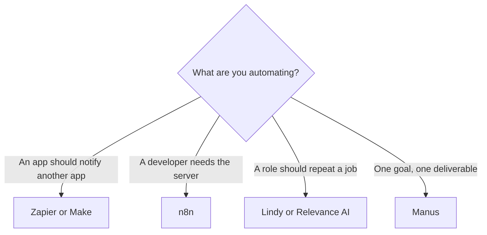

**Leave Zapier for an AI workflow when the meter, the editor, or the shape of the work is wrong.** Stay when a non-developer needs a known app connected this week and 750 tasks a month will cover it. Make and n8n are the other glue. Lindy, Relevance AI, and Manus are agents. An agent is a different purchase from a Zap that calls a model once.

[Zapier](/tools/zapier/) Free is 100 tasks a month. Professional is $19.99 a month billed annually for 750 tasks. The three-way with the other connectors is [Zapier vs Make vs n8n](/blog/zapier-vs-make-vs-n8n/). The product page is [Zapier review](/blog/zapier-review-2026/). A first workflow, before any model, is [how to automate work with Zapier and Make](/blog/how-to-automate-work-with-zapier-and-make/).

Prices are US list prices excluding tax from directory pages checked October 16, 2026, except Lindy, which was read from its pricing page on October 24, 2026 for the review linked below. n8n's cloud prices were displayed in euros and are not converted. Published October 24, 2026. We did not measure how often an agent finishes unattended.

## Pick by the shape

| The shape | Open | First paid step |
|---|---|---|
| A reliable Zap, and the AI call is one step | Stay on [Zapier](/tools/zapier/) | Professional $19.99/month annually, 750 tasks |
| A visual scenario with more room at the entry tier | [Make](/tools/make/) | Core from $9/month annually, from 10,000 credits |
| A developer will own it, or it must self-host | [n8n](/tools/n8n/) | Cloud Starter €20/month annually, 2,500 executions. Community Edition is free to self-host |
| A recurring job you would hand to a person | [Lindy](/tools/lindy/) | $29.99 per user per month for 3,000 credits, from the October 24 pricing page |
| An agent with a published action meter and vendor credits | [Relevance AI](/tools/relevance-ai/) | Pro $19/month annually, or $29 monthly, with 2,500 actions a month |
| A goal that returns a document, a site, or a deck | [Manus](/tools/manus/) | Pro from $20/month for 4,000 credits |

The definition that keeps these rows apart is [what an AI agent is](/blog/what-is-an-ai-agent-2026/). Calling a model from a Zap is a step. An agent that chooses its next step is a product.

## Glue, if Zapier's task price is the complaint

**Make meters credits.** Free is 1,000 credits a month. Core starts at $9 a month on annual billing at the 10,000-credit tier. Pro starts at $16 and Teams at $29, at that same base tier, with higher tiers available. Monthly billing costs more than annual. The page we used did not fully render, so these figures come from Make's comparison article and Help Center as recorded in the directory. A branching scenario with an AI module fits Make when someone on the team can read a credit log.

**n8n meters executions.** Community Edition is free if you self-host. Cloud Starter is €20 a month billed annually for 2,500 executions. Pro is €50 for 10,000. Business is €667 for 40,000 and is the self-hosted paid tier in that table. Unlimited users and workflows are on all plans. Choose n8n when the data should stay on a server you operate, or when a developer wants code in the path. Read the license on the edition you install. The open-source wording trap is [what open-source AI is](/blog/what-is-open-source-ai-2026/).

Zapier Team at $69 a month billed annually is the admin upgrade: shared folders, roles, and SAML SSO. If the pain is governance, Team is the Zapier answer. If the pain is the task price on a high-volume AI loop, model Make or n8n on one real scenario before you migrate the library.

## Agents, if you wanted an employee

**Lindy bills active users and credits.** The October 24, 2026 pricing page, recorded in [Lindy review](/blog/lindy-review-2026/), starts paid use at $29.99 per user per month for 3,000 credits. Top-ups are $10 per 1,000 credits. A trial offers $50 in credits with no card. Use Lindy when the job is email, research, or a follow-up that recurs. A Zap that posts to Slack is still Zapier.

**Relevance AI bills actions and vendor credits.** Pro is $19 a month billed annually, or $29 month to month, with 2,500 actions a month and $20 in vendor credits. Team is $234 a month annually, or $349 monthly. Two build users are on Pro. This is the quote when you want the action count in the contract. Confirm the current card. The directory check is October 16, 2026.

**Manus takes a goal.** Pro starts at $20 a month for 4,000 credits, with a $40 option for 8,000. Team starts at $20 per seat. Free includes 300 daily credits on the directory page. The output is a deliverable. It is the wrong swap for a two-app integration you need to run every hour with a log your ops lead can read. The review is [Manus AI review](/blog/manus-ai-review-2026/).

## A test that keeps the migration small

1. Write the workflow in one sentence, including the system it must not email or charge.
2. Build the path with the model turned off. Confirm the record lands in the right place.
3. Add one AI step. Log the meter for a week: Zapier tasks, Make credits, n8n executions, or agent credits.
4. Move only if the week shows a real miss: price, hosting, or a job no Zap can describe.

An API you call from your own code is the step after these tools, when the workflow is the product. That split is [what an API for AI tools is](/blog/what-is-an-api-for-ai-tools-2026/).

## FAQ

### What is the cheapest published alternative to Zapier?

Make Core from $9 a month billed annually, at the 10,000-credit tier, is the lower published cloud price in this set. n8n Community Edition is free to self-host, which is cheaper in license fees and costs whatever the server costs. Lindy at $29.99 is an agent, so it is not a discount on a Zap.

### Should I replace Zapier with an AI agent?

Replace it when the work is a role: triage, follow-up, research on a trigger. Keep Zapier when the work is a fixed path between apps. Agents spend credits on judgment. Zaps spend tasks on steps you specified.

### Does Zapier already have AI steps?

Yes. Free includes AI tools in the directory's plan notes, inside the 100-task cap. Professional is where multi-step Zaps and premium apps open up. An AI step can also multiply tasks. Read the task count on one live Zap before you call the plan too small.

### Is n8n's euro price a US dollar price?

No. The pricing page was displayed to us in euros. Check the currency on your checkout. This article leaves €20, €50, and €667 as euros.

## Last verified

October 16, 2026 for Zapier, Make, n8n, Relevance AI, and Manus. October 24, 2026 for Lindy's $29.99 and 3,000-credit figure. Published October 24, 2026.

**Sources:** [Zapier pricing](https://zapier.com/pricing), [Make pricing](https://www.make.com/en/pricing), [n8n pricing](https://n8n.io/pricing/).

*Published by Andrew for [AI Tools Optimizer](https://aitoolsoptimizer.com).*

[Zapier](/tools/zapier/), [Make](/tools/make/), and [n8n](/tools/n8n/) are in the [automation directory](/tools/category/automation-agents/). Directory pages may use affiliate links. A purchase through them may earn us a commission at no extra cost to you.
