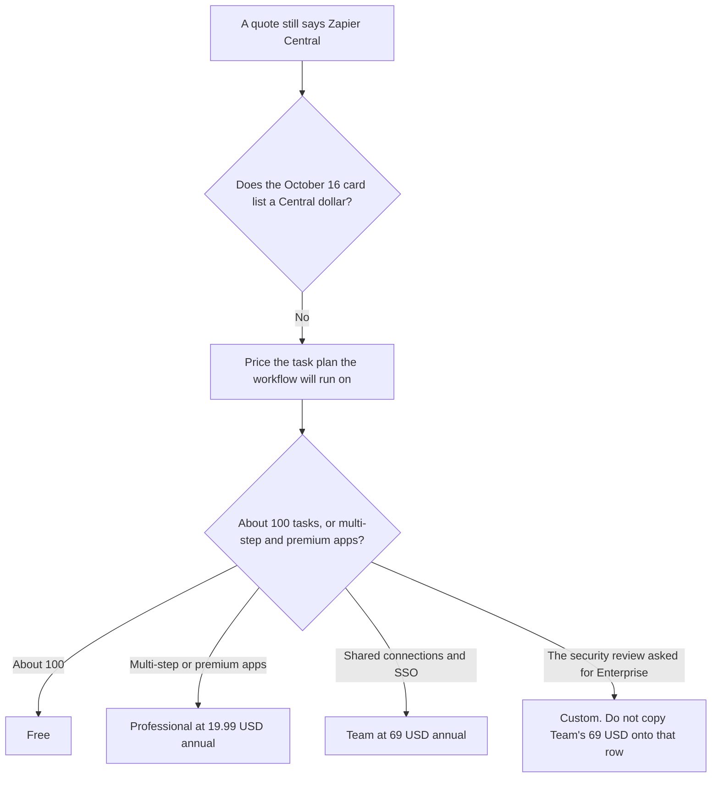

**The Zapier directory card checked October 16, 2026 does not list a Zapier Central price.** It lists Free, Professional, Team, and Enterprise, and it describes Agents, Zapier Copilot, and Zapier MCP as part of the product on those plans. A company buying "Central" on that card is buying a task plan, not a second subscription this page can quote. The task ladder is [Zapier pricing explained](/blog/zapier-pricing-explained-2026/).

The product page is [Zapier review](/blog/zapier-review-2026/). The credit-priced alternative is [Make pricing explained](/blog/make-pricing-explained-2026/).

A live fetch of zapier.com/central returned HTTP 401 on October 24, 2026, and so did the pricing page. This article stays on the October 16 card. Published October 24, 2026. Prices are USD as that card records them. We did not score agents. If a cart shows a Central add-on, the cart is the price. This page does not invent one.

## What the card lets you quote

| Plan | Price recorded | What an agent-style workflow draws on | What the card does not say |
|---|---|---|---|
| Free | $0, 100 tasks a month | Unlimited Zaps, and the core suite, including AI tools | A Central seat |
| Professional | $19.99 a month billed annually, 750 tasks, then an overage per task | Multi-step Zaps and premium apps | The overage dollar. Read it in the account |
| Team | $69 a month billed annually | Shared folders and connections, roles, SAML SSO | A task allotment. Do not assume 750 |
| Enterprise | Custom | Enterprise security and governance | A list price |

A year of Professional at the recorded rate is 12 × $19.99 = $239.88. A year of Team is 12 × $69 = $828. The card records both as billed annually and does not print a higher month-to-month dollar, so this page does not invent one. Higher task tiers exist. The directory says to check the pricing page for volume. It does not list those tiers here. Paid plans start with a 14-day trial on that card.

Filters, Paths, and Formatter steps do not count as tasks, on the card. An agent step that successfully writes to another app can be a task. Count the writes. Do not count the nickname "Central" as unlimited.

## What you are paying for instead of a Central SKU

**The task.** [Zapier](/tools/zapier/) Professional is the plan for multi-step work and premium apps. An agent that creates a contact and posts to chat can be two tasks if both actions succeed. The invoice is the pricing article above. The boundary on a live write is [what an AI tool sandbox is](/blog/what-is-ai-tool-sandbox-2026/).

**The cap on one named agent, if you run more than one.** That ceiling is yours to write. The explainer is [what an AI agent budget cap is](/blog/what-is-ai-agent-budget-cap-2026/). Zapier's card does not print that cap for you.

**A different meter.** [Make](/tools/make/) Core starts at $9 a month billed annually for 10,000 credits, on the October 16 card. A credit is not a Zapier task. Compare them when the workflow is the same and you can explain the unit.

**The instructions the agent must follow.** [Claude](/tools/claude/) Pro is $17 a month billed annually, $200 up front, or $20 monthly, on claude.com/pricing fetched October 24, 2026. The Project holds the steps a person wrote. It does not mint Zapier tasks. [Notion AI](/tools/notion-ai/) Business is $20 a seat a month on the October 16 card, if the runbook lives in the wiki. The invoice is [Notion AI pricing explained](/blog/notion-ai-pricing-explained-2026/).

## What not to assume

Do not budget a Central seat at Professional's price, or at zero, because the card is silent. Silence means you do not have a list price. Do not treat "AI tools" on Free as an uncapped agent. Free is 100 tasks. Do not let an agent issue a refund or send a customer email without the same approval you would require from a person. Do not convert another vendor's euro price into this table.

## FAQ

### How much is Zapier Central?

This page cannot quote a Central dollar. The October 16 card does not list one, and a live fetch of the Central URL returned HTTP 401 on October 24, 2026. Quote the task plan the workflow will use: Free, Professional at $19.99 a month billed annually, Team at $69 a month billed annually, or Enterprise as custom. If checkout shows a line this card does not have, checkout wins, and write that number down with the date.

### Do Agents cost extra?

The card describes Agents, Copilot, and MCP as product capabilities and prices the plans by tasks and admin features. It does not print an agent add-on. It also does not say agents are free of tasks. A successful action still counts as a task, on the definition in the pricing article.

### Is Team required to use an agent?

The card ties shared folders, shared connections, roles, and SAML SSO to Team. It does not say a single owner is forbidden from using AI tools on Free or Professional. Two people sharing a login is not the Team plan. If the security review asked for SSO, Team is the row with a dollar, and Enterprise is the custom row.

### How is this different from the main Zapier pricing article?

That article is the task definition and the four plans. This article is the Central name: there is no second price to paste into a forecast, and the bill is still tasks. Read both before you approve a purchase order that says Central.

## Last verified

October 16, 2026, from the directory card. Make's comparison price is the same date. Claude's comparison price is October 24, 2026. Notion is October 16. Published October 24, 2026. Zapier's Central URL and pricing page returned HTTP 401 that day.

**Sources:** [Zapier pricing guide](https://zapier.com/blog/zapier-pricing/), [Zapier](https://zapier.com), [Make pricing](https://www.make.com/en/pricing).

*Published by Andrew for [AI Tools Optimizer](https://aitoolsoptimizer.com).*

[Zapier](/tools/zapier/) is in the [automation and agents directory](/tools/category/automation-agents/). Directory pages may use affiliate links. A purchase through them may earn us a commission at no extra cost to you.
