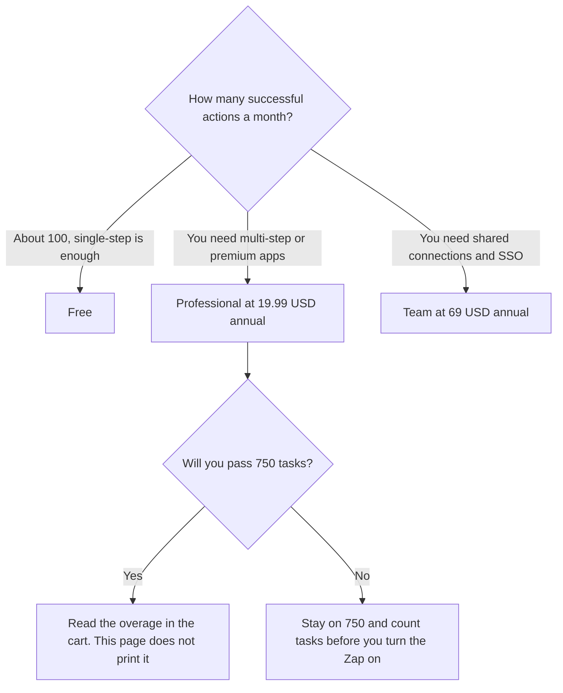

**Zapier Professional is $19.99 a month billed annually, with 750 tasks a month. Free is 100 tasks a month. Team is $69 a month billed annually. Enterprise is custom.** A task is an action a Zap successfully completes. Filters, Paths, and Formatter steps do not count as tasks, on the directory card. The plan you want is the one whose task definition matches the writes you will actually run. A cheap plan that writes the live CRM on every test is not cheap.

The product page is [Zapier review](/blog/zapier-review-2026/). The credit-priced alternative is [Make pricing explained](/blog/make-pricing-explained-2026/). The euro-priced, self-hostable alternative is [n8n pricing explained](/blog/n8n-pricing-explained-2026/). The clock on one step is [what an AI tool timeout is](/blog/what-is-ai-tool-timeout-2026/).

Prices are US list prices excluding tax from Zapier's pricing guide as recorded in the directory on October 16, 2026. A live fetch of the pricing page returned HTTP 401 on October 24, 2026, so this page stays on the directory record. Published October 24, 2026. We did not score automation reliability.

## The plans

| Plan | Price recorded | Tasks | What the card highlights |
|---|---|---|---|
| Free | $0 | 100 a month | Unlimited Zaps, Tables, Forms, and AI tools |
| Professional | $19.99 a month billed annually | 750 a month, then an overage per task | Multi-step Zaps, premium apps, a 14-day trial |
| Team | $69 a month billed annually | The directory does not print a task allotment | Shared folders and connections, roles, SAML SSO |
| Enterprise | Custom | Custom | Enterprise security and governance |

A year of Professional at the recorded rate is 12 × $19.99 = $239.88. A year of Team is 12 × $69 = $828. The directory records both as billed annually and does not print a higher month-to-month dollar, so this page does not invent one. Higher task tiers exist. The directory says to check the pricing page for your volume. It does not list those tiers here.

## What you are choosing besides the dollar

**Free** is enough to learn and to run a few small Zaps. One hundred successful actions is the cap. A Zap that creates a contact, sends a mail, and posts to chat can be three tasks. Filters that skip a row do not add a task.

**Professional** is the plan for multi-step Zaps and premium apps. Overage tasks are billed per completed task past the limit. The directory does not print the per-task overage dollar. Use the number in your account. Do not multiply 750 by a rate you found on a forum.

**Team** is the admin jump: shared folders and connections, user roles, and SAML SSO. Because the task allotment is blank on the card this article uses, do not assume Team includes 750, or ten times 750. Ask, and write the number down.

**Make and n8n** are different meters. [Make](/tools/make/) Core starts at $9 a month billed annually for 10,000 credits. A credit is not a Zapier task. [n8n](/tools/n8n/) Starter is €20 a month billed annually in the directory. This page does not convert euros to dollars. Compare them when the job is the same workflow and you can explain the unit. The reviews are [Zapier review](/blog/zapier-review-2026/) and the two pricing articles linked above.

A test that writes a real customer is not a free action. Point the Zap at a record you can delete. The boundary is [what an AI tool sandbox is](/blog/what-is-ai-tool-sandbox-2026/).

## What not to assume

Do not divide one login across a team to stay on Professional. Team is the shared-connection plan. Do not treat "unlimited Zaps" as unlimited tasks. The Zap count and the task count are different sentences. Do not let an AI step call a refund or an email without the same approval you would require from a person. The gate on the model's output, before the Zap acts, is [what AI output validation is](/blog/what-is-ai-output-validation-2026/).

## FAQ

### Is Zapier free?

Yes. Free includes 100 tasks a month, unlimited Zaps, and the core suite the card names, including Tables, Forms, and AI tools. Multi-step Zaps and premium apps are why people move to Professional.

### What counts as a task?

A successful action, such as creating a contact. Filters, Paths, and Formatter steps do not count. A Zap that errors before the action may not be the same as a task, and a timeout is not proof the other system did nothing. Check the run history.

### What happens past 750 tasks?

On Professional, the directory says automations keep running and you are charged per task over the limit. It does not print the rate. Read it in the product before you leave a Zap on over a weekend.

### Is Team required for two people?

The directory ties shared folders, shared connections, roles, and SAML SSO to Team. Two people emailing each other a login is not the Team plan. If you only need a higher task tier and not those admin features, price the Professional tier that matches the volume, and confirm that tier's dollar on the pricing page.

## Last verified

October 16, 2026, from Zapier's pricing guide as recorded in the directory. Make and n8n figures are from the same directory date. Published October 24, 2026. A live fetch of Zapier's pricing page returned HTTP 401.

**Sources:** [Zapier pricing guide](https://zapier.com/blog/zapier-pricing/), [Zapier](https://zapier.com), [Make pricing](https://www.make.com/en/pricing).

*Published by Andrew for [AI Tools Optimizer](https://aitoolsoptimizer.com).*

[Zapier](/tools/zapier/) is in the [automation and agents directory](/tools/category/automation-agents/). Directory pages may use affiliate links. A purchase through them may earn us a commission at no extra cost to you.
