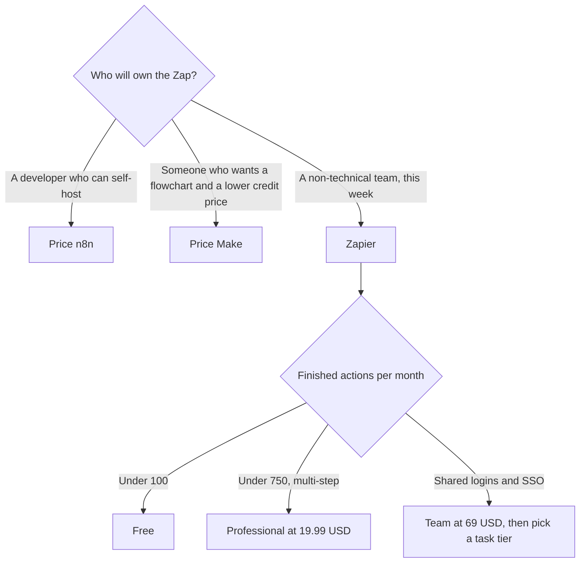

**[Zapier](/tools/zapier/) connects apps with Zaps, and a task is an action that completes.** Free includes 100 tasks a month and unlimited Zaps, plus Tables, Forms, and AI tools. Professional is $19.99 a month billed annually after a 14-day trial, with 750 tasks, multi-step Zaps, and premium apps. Extra tasks on that plan are billed per task. Team is $69 a month billed annually, with shared folders and connections, user roles, and SAML SSO. Enterprise is custom.

Prices are US dollars from Zapier's pricing guide, recorded October 16, 2026. Higher task tiers cost more than the 750-task Professional entry. Tax and currency can differ. We did not load-test a Zap, and we did not score AI Agents against a human operator.

This page is the Zapier contract. The three-way choice is [Zapier vs Make vs n8n](/blog/zapier-vs-make-vs-n8n/). Make's own numbers are in the [Make review](/blog/make-com-review-2026/). n8n's cloud price, in euros, is in the [n8n review](/blog/n8n-cloud-review-2026/).

## The meter, with the free steps called out

| Plan | Price | Tasks | What you came for |
|---|---|---|---|
| Free | $0 | 100 a month | Unlimited Zaps. Tables, Forms, and AI tools in the core suite |
| Professional | $19.99/month billed annually | 750 a month at the entry tier, then per-task overage | Multi-step Zaps, premium apps, Filters, Paths, Formatter |
| Team | $69/month billed annually | Confirm the task tier on the live page. The guide we used prices the seat features here | Shared folders and connections, roles, SAML SSO |
| Enterprise | Custom | Custom | Governance and security beyond Team |

Filters, Paths, and Formatter steps do not count as tasks. A path that checks "country is not empty" and then creates one CRM contact is one task for the contact, not a task for the check. An AI step that completes as an action counts as a task. Zapier does not, in the guide we used, add a second multiplier on top of that action.

## A task estimate you can do on paper

Twenty new leads a day, each creating a CRM contact, a Slack message, and a row in a sheet, is 3 actions × 20 × 30 days = 1,800 tasks a month. Filters in front of that do not add to the 1,800. The 1,800 is already past Professional's 750-task entry, so you are on a higher Professional tier or on overage. Overage keeps the Zap running and bills the extra completed tasks. That is convenient and easy to miss.

Do the estimate before you turn the Zap on:

1. List every action that creates, updates, or sends something.
2. Ignore Filters, Paths, and Formatter.
3. Multiply by a real month of volume, including the busy week.
4. Compare the total with 100 and with 750.
5. If the total is in the thousands every month, price [Make](/tools/make/) Core, from $9 a month billed annually for 10,000 credits, using the [Make review](/blog/make-com-review-2026/). Make's credit and Zapier's task are not the same unit. Compare them only after you know how many of each your scenario spends.

n8n Cloud Starter is listed at €20 a month billed annually for 2,500 executions. This review does not convert euros to dollars. Self-hosting n8n is a different cost, mostly your time and a server. [Lindy](/tools/lindy/) and [Manus](/tools/manus/) are the products to open when you want an agent that researches, rather than a Zap that moves a row. Manus Pro starts at $20 a month. See the [Manus review](/blog/manus-ai-review-2026/).

Zapier also ships Agents, Copilot for building Zaps, and MCP so an assistant can call the same app library. Those sit on top of the task meter when they complete actions. Tables and Forms are included in the core suite on Free, which is enough to prototype a lead form without another subscription.

## Fit score

| Need | Free | Professional $19.99 annual | Team $69 annual |
|---|---|---|---|
| A two-step Zap under 100 actions | Strong | More than you need | More than you need |
| Multi-step Zaps and premium apps | No | Yes | Yes |
| Logic steps without spending tasks | Limited by the free feature set | Filters, Paths, Formatter are free of the meter | Same |
| Shared connections and SSO | No | No | Yes |
| A self-hosted runner | No | No | No |
| Predict a high-volume bill | 100-task ceiling | Only after you pick a tier above 750 or accept overage | Confirm the task pack |

The score is the contract. It is not a reliability score. Zapier's status page, not this review, is where uptime lives.

## FAQ

### Is Zapier free?

Yes. 100 tasks a month, unlimited Zaps, and the core suite of Tables, Forms, and AI tools.

### How much does Zapier cost?

Professional is $19.99 a month and Team is $69 a month, both billed annually, after a 14-day trial. The Professional entry includes 750 tasks. Larger packs cost more. Enterprise is custom.

### What counts as a task?

An action the Zap completes, such as creating a contact. Filters, Paths, and Formatter steps do not count.

### What if I go over?

On Professional, Zaps keep running and completed tasks past the allowance are billed per task. Watch the first busy week.

## Last verified

October 16, 2026.

**Sources:** [Zapier pricing guide](https://zapier.com/blog/zapier-pricing/), [Zapier](https://zapier.com).

[Zapier](/tools/zapier/) is in the [automation directory](/tools/category/automation-agents/). Directory pages may use affiliate links. A purchase through them can earn us a commission at no extra cost to you.
