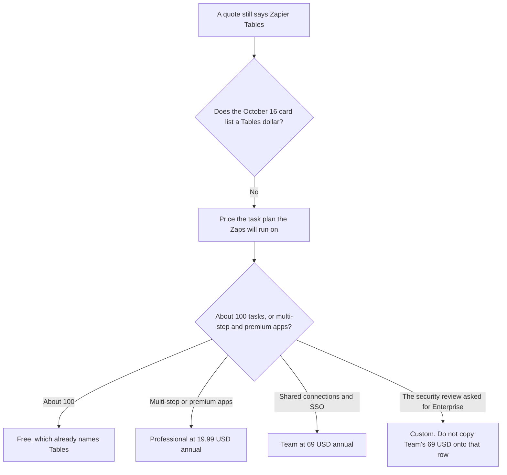

**The Zapier directory card checked October 16, 2026 does not list a Zapier Tables price.** It says Free includes 100 tasks a month, unlimited Zaps, and the core suite, including Tables, Forms, and AI tools. A company buying Tables on that card is buying a task plan that includes Tables, not a second subscription this page can quote. The task ladder is [Zapier pricing explained](/blog/zapier-pricing-explained-2026/). The agent-style name with the same problem, a missing add-on dollar, is [Zapier Central pricing explained](/blog/zapier-central-pricing-explained-2026/).

The product page is [Zapier review](/blog/zapier-review-2026/). A database that is the whole product, rather than a table inside the automation tool, is a different invoice. [Notion AI](/tools/notion-ai/) Business is $20 a seat a month on the October 16 card.

A live fetch of the Zapier pricing guide returned HTTP 401 on October 24, 2026. This article stays on the October 16 card. Published October 24, 2026. Prices are USD as that card records them. We did not score Tables. If a cart shows a Tables add-on, the cart is the price. This page does not invent one.

## What the card lets you quote

| Plan | Price recorded | What Tables draws on | What the card does not say |
|---|---|---|---|
| Free | $0, 100 tasks a month | Unlimited Zaps, and the core suite, including Tables | A Tables seat, a row cap, or a storage cap |
| Professional | $19.99 a month billed annually, 750 tasks, then an overage per task | Multi-step Zaps and premium apps | The overage dollar. Read it in the account |
| Team | $69 a month billed annually | Shared folders and connections, roles, SAML SSO | A task allotment. Do not assume 750, and do not assume a larger Tables quota |
| Enterprise | Custom | Enterprise security and governance | A list price for Tables or for the plan |

A year of Professional at the recorded rate is 12 × $19.99 = $239.88. A year of Team is 12 × $69 = $828. The card records both as billed annually and does not print a higher month-to-month dollar, so this page does not invent one. Paid plans start with a 14-day trial on that card. Higher task tiers exist. The directory says to check the pricing page for volume. It does not list those tiers, and it does not list Tables tiers.

## What a table does to the task count

Tables is where a Zap can store a row. The card does not say that looking at a table is a task. It says a task is an action a Zap successfully completes. Filters, Paths, and Formatter steps do not count. A Zap that creates a record in another app, or writes a row because an action step did, can be a task. Count the successful actions. Do not count the word "Tables" as unlimited tasks.

The card does not print a row limit, a storage limit, or a per-seat Tables price. If your account shows one, use that number. A missing limit on this page is not a promise of unlimited rows.

**Free** is the plan that already names Tables. One hundred tasks is the cap. A table with no Zaps does not, on this card, have a separate meter. A Zap that fires on every row can spend the 100 quickly.

**Professional** is the plan when the Zaps are multi-step or use premium apps. The table is still not a second SKU on the card. Overage tasks are billed per completed task past 750. The per-task dollar is not on the card.

**Team** is shared folders, shared connections, roles, and SAML SSO. It is not "Tables for teams" at $69 unless you need those admin lines. The task allotment is blank. Ask before you assume the table's Zaps are covered.

## What not to merge it with

**Central.** Agents, Copilot, and MCP are described on the same plans. Central's missing dollar is the other article. Tables is the database line in the core suite. Do not add the two nicknames and call them one product with one invented price.

**Make's credits.** [Make](/tools/make/) Core starts at $9 a month billed annually for 10,000 credits. A credit is not a Zapier task, and Make is not Tables. The invoice is [Make pricing explained](/blog/make-pricing-explained-2026/).

**A chat seat.** [Claude](/tools/claude/) Pro is $17 a month billed annually, or $20 monthly. Drafting a formula in chat does not include Zapier tasks. The task plan is still Zapier's.

## FAQ

### Is Zapier Tables free?

The October 16 card includes Tables in the Free plan's core suite, next to Forms and AI tools. Free is 100 tasks a month. Tables on that sentence is not a separate $0 product with its own fair-use page. If a later cart adds a Tables price, the cart wins. This page does not have that cart.

### Do rows count as tasks?

The card defines a task as a successful action, and it says Filters, Paths, and Formatter do not count. It does not say a stored row is free or billable on its own. A Zap that acts on a row can spend a task. Read the run history for the Zap you turned on. Do not multiply rows by $19.99.

### How is this different from the Zapier pricing article?

That article is the task ladder: Free, Professional at $19.99, Team at $69, Enterprise custom. This article is the Tables line on that ladder, which has no dollar of its own. Use the pricing article for tasks. Use this page when someone asks what Tables costs and the honest answer is the plan, not a second sticker.

### Is Team required to share a table?

The card ties shared folders, shared connections, roles, and SAML SSO to Team. It does not print a separate "shared Tables" requirement. If two people need those admin features, Team is the plan at $69 annual. If they only need a higher task tier, price the Professional tier that matches the volume and confirm it in the product. Do not buy Team because the word Tables appeared in a sentence.

## Last verified

October 16, 2026, from Zapier's pricing guide as recorded in the directory. A live fetch of that guide returned HTTP 401 on October 24, 2026. Notion, Make, and the Claude comparison use the same directory date, with Claude's $17 annual figure from the October 24 pricing article. Published October 24, 2026.

**Sources:** [Zapier pricing guide](https://zapier.com/blog/zapier-pricing/), [Zapier](https://zapier.com), [Make pricing](https://www.make.com/en/pricing).

*Published by Andrew for [AI Tools Optimizer](https://aitoolsoptimizer.com).*

[Zapier](/tools/zapier/) is in the [automation and agents directory](/tools/category/automation-agents/). Directory pages may use affiliate links. A purchase through them may earn us a commission at no extra cost to you.
