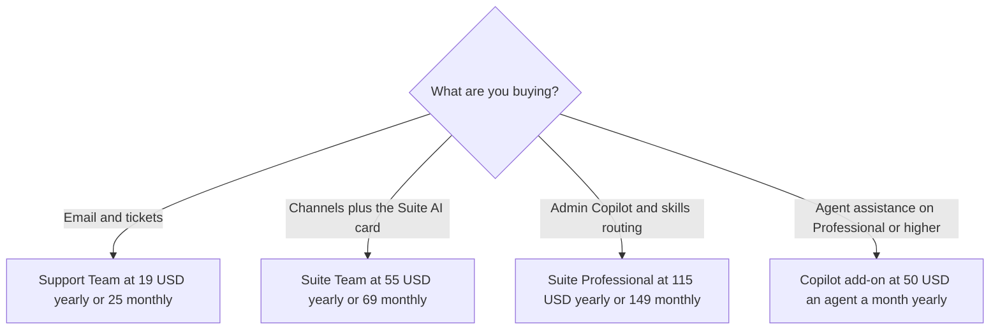

**On zendesk.com/pricing fetched October 24, 2026, yearly prices were Support Team at $19 an agent a month, Suite Team at $55, and Suite Professional at $115.** Monthly prices on the compare table were $25, $69, and $149. The page said annual billing is 20% off. Copilot as an add-on was $50 an agent a month paid yearly. Suite Enterprise was "Talk to Sales" on the card labeled Suite Enterprise + Copilot.

An outcome-priced alternative is [Intercom Fin pricing explained](/blog/intercom-fin-pricing-explained-2026/). A smaller chat stack is [Tidio pricing explained](/blog/tidio-pricing-explained-2026/). The swarm you write when a launch breaks the queue is [how to create a support swarm plan with AI](/blog/how-to-create-a-support-swarm-plan-with-ai-2026/).

Published October 24, 2026. Figures are USD from that page. We did not score deflection. We did not see a tax line. The October 16 directory card matches the yearly seat prices and does not list the monthly column or the resolution unit prices below.

## The seats on the October 24 page

| Plan | Yearly, per agent per month | Monthly, per agent per month | What the plan card adds |
|---|---|---|---|
| Support Team | $19 | $25 | Email, ticketing, routing, dashboards, automations |
| Suite Team | $55 | $69 | The card lists AI Agents, Knowledge Base, Action Builder, omnichannel, messaging, telephony |
| Suite Professional | $115 | $149 | Admin Copilot, App Builder, Writing Tools, Quick Reports, skills-based routing, IVR |
| Suite Enterprise + Copilot | Contact sales | Contact sales | The card names triage, auto assist, generative AI for voice, sandbox, custom roles |

The compare table also lists included automated resolutions: 5 per agent a month on Support Team, 5 per agent a month on Suite Team, and 10 per agent a month on Suite Professional, with a header that says up to 10,000 a year. The committed automated resolutions row prints $1.50 on each of those three columns. The pay-as-you-go resolutions row prints $2.00 on each. The page says an automated resolution is a request the AI resolved without a human, and that you pay for those successes. The cells themselves do not repeat the words "per resolution." Read them as the unit prices on those rows, and confirm the unit at checkout.

There is a tension to keep. The Suite Team card lists "AI Agents" as a feature Support Team's card does not list. The FAQ on the same page says AI agents are included in every Suite and Support plan, and the compare table gives Support Team an included resolution allowance. The October 16 directory card said AI Agents start with Suite Team. This article does not collapse those lines. If your checkout's Support Team row has no AI agent, the checkout wins.

## Add-ons and neighbors

**Copilot** at $50 an agent a month paid yearly is the featured add-on. A later line on that page says Copilot can be added to Professional and higher. Do not assume the $50 add-on attaches to Support Team because the word Copilot appears in a marketing sentence.

**Contact Center** was $83 an agent a month paid yearly. Quote it only if you are buying that add-on.

**Action credits** were listed at $200 per 100,000 actions per subscription term, as an add-on, on the compare table. Included action allowances differ by plan. This article does not reprint every allowance. Read the row for the plan you are on.

**Intercom Fin**, on the October 16 card, is $49 a month including 50 outcomes, then $0.99 an outcome. That is a different meter from a Zendesk seat plus resolutions. [Tidio](/tools/tidio/) Starter is $24.17 a month billed annually on that card. [Notion AI](/tools/notion-ai/) Business at $20 a seat a month is a wiki, not a help desk. The invoice is [Notion AI pricing explained](/blog/notion-ai-pricing-explained-2026/).

The page said the default trial is Suite Professional for 14 days, with Copilot included in that trial. A trial price is not the renewal.

## What not to assume

Do not multiply $55 by headcount and call it the AI budget. Add the resolution row you will actually use, and Copilot if you are on a plan that can take it. Do not treat the marketing line about resolving a large share of issues as a number you measured. We did not. Do not ignore the monthly column if you are not on annual billing.

## FAQ

### How much is Zendesk Suite Team?

$55 per agent per month paid yearly, or $69 per agent per month paid monthly, on zendesk.com/pricing fetched October 24, 2026. The yearly Support Team price is $19, and Suite Professional is $115.

### How much is an automated resolution?

The compare table prints $1.50 on the committed row and $2.00 on the pay-as-you-go row, for Support Team, Suite Team, and Suite Professional. Included allowances on that table are 5, 5, and 10 per agent a month. Confirm the unit in checkout. The October 16 directory card did not list these unit prices.

### Is Copilot included?

The $50 a month yearly add-on is separate from the Suite Team seat. The page says Copilot can be added to Professional and higher. Suite Enterprise's card is named Suite Enterprise + Copilot and has no list price. The 14-day default trial includes Copilot. That inclusion is the trial, not the Suite Team renewal.

### Is there a free plan?

No free plan was listed. Trials were. A startup program mentioned on the page is a 6-month Suite trial for early-stage startups, up to 50 agents. Read the terms. It is not a permanent free help desk.

## Last verified

October 24, 2026, from zendesk.com/pricing. The October 16 directory card agrees on the yearly Support Team, Suite Team, Suite Professional, Copilot, and Contact Center seat figures, and it places AI Agents at Suite Team. Published October 24, 2026.

**Sources:** [Zendesk pricing](https://www.zendesk.com/pricing/), [Intercom Fin](https://fin.ai), [Tidio pricing](https://www.tidio.com/pricing/).

*Published by Andrew for [AI Tools Optimizer](https://aitoolsoptimizer.com).*

[Zendesk AI](/tools/zendesk-ai/) is in the [customer support directory](/tools/category/customer-support/). Directory pages may use affiliate links. A purchase through them may earn us a commission at no extra cost to you.
